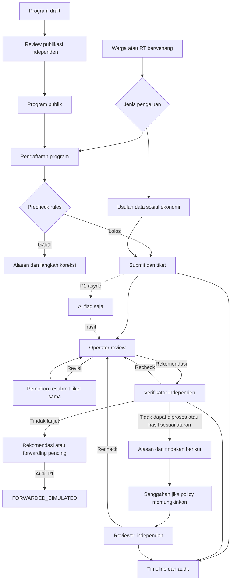
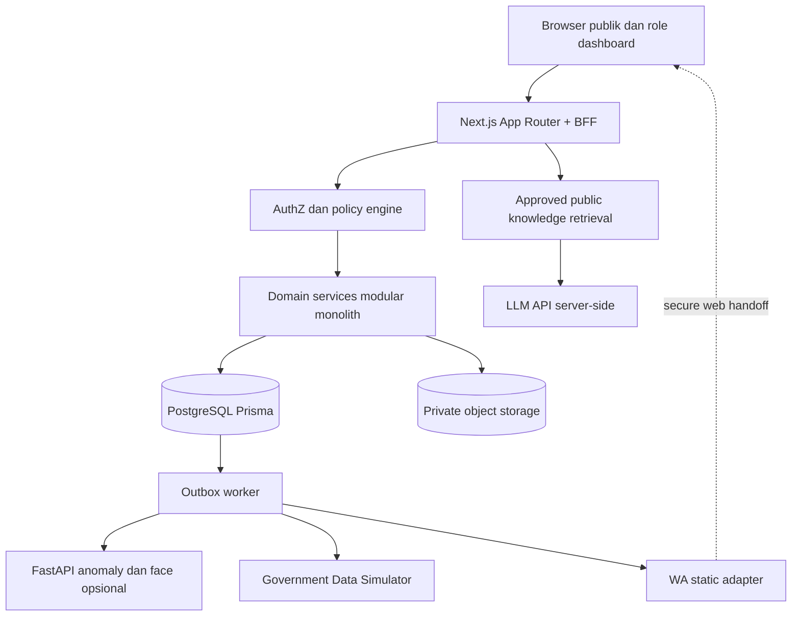
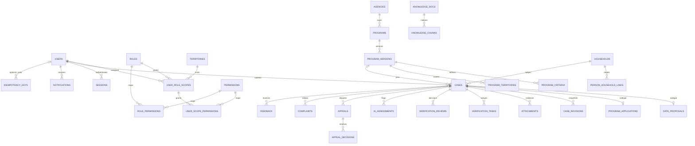

# BantuTepat — Product Requirements Document (PRD)

**Digital Public Service & Social Assistance Transparency Platform**

| Metadata | Nilai |
|---|---|
| Versi | 1.2 — kandidat freeze untuk persetujuan tim |
| Tanggal | 26 November 2026 |
| Produk | BantuTepat |
| Kompetisi | Techcomfest 2027 — Web Application Competition |
| Subtema | Smart Governance & Public Service — SDG 16 |
| Target rilis | Sebelum 18 Desember 2026, 23.59 WIB |
| Audiens | Product owner, UI/UX, frontend, backend, AI engineer, QA, Codex |
| Status | Requirements; bukan bukti fitur telah diimplementasikan |

## 0. Cara menggunakan PRD

PRD ini menetapkan **apa yang harus dibangun, untuk siapa, mengapa, urutan pengembangan, dan bagaimana keberhasilannya diterima**. Master Specification tetap menjadi acuan detail engineering, sedangkan diagram Draw.io adalah referensi visual. Setiap perubahan kontrak wajib dicatat sebagai keputusan arsitektur (ADR), disetujui tim, lalu diperbarui pada PRD, kontrak, dan tes. Jangan mulai implementasi lintas modul sebelum kontrak fase 0 dibekukan.

Sumber internal:
- `BantuTepat_MASTER_SPEC_Codex_FINAL.md` (selanjutnya **MS**, rujukan nomor bagian dan diagram).
- `Pasted text.txt` (selanjutnya **Brief**, bagian 1–11, termasuk prioritas dan stack).
- `BantuTepat_MASTER_DIAGRAM_30_Drawio.drawio` dan `BantuTepat_Drawio_Manifest.json` (30 nomor diagram, 31 halaman karena diagram 11 terbagi menjadi dua).
- `Rulebook WEB APP Techcomfest 2027.pdf` (selanjutnya **RB**, halaman tercetak 3–8).

Ketika membaca lampiran kontrak di bawah, judul bernomor 3.x, 4.x, 6.x, dan 16.x adalah nomor asli MS, bukan nomor bab PRD. ID FR, NFR, dan TASK merupakan ID baru yang dibuat untuk traceability. Semua target internal masih harus diuji. Tidak ada klaim integrasi pemerintah, kepatuhan hukum resmi, ataupun peningkatan nyata di masyarakat.

## 1. Executive summary

BantuTepat adalah satu aplikasi web multi-role yang mempermudah akses informasi bantuan sosial, usulan/koreksi data sosial ekonomi, pendaftaran program tertentu, pemeriksaan bertahap, tracking, dan penyampaian sanggahan atau pengaduan. Nilai utama adalah proses pelayanan yang jelas, terukur dan dapat diaudit, bukan penentuan penerima otomatis. Pemeriksaan manusia tetap menentukan hasil administratif sesuai mandat. AI membantu menandai anomali; layanan informasi web menggunakan LLM + RAG; WhatsApp memakai menu deterministik. Pertukaran data pemerintah hanya simulasi terisolasi dengan data sintetis.

**Visi:** masyarakat memahami langkah pengajuan dan alasan hasil pemeriksaan; petugas bekerja sesuai wilayah, tanggung jawab, serta jejak keputusan yang dapat ditelusuri.

**Proposisi nilai:** satu akses informasi, dua jenis pengajuan yang jelas, pemeriksaan independen, transparansi yang menjaga privasi, serta kanal koreksi dan pengaduan yang terpisah.

## 2. Problem statement dan sasaran

| Masalah | Kebutuhan produk | Bukti keberhasilan demo |
|---|---|---|
| Informasi program tersebar dan syarat tidak jelas | Katalog, detail, cakupan, periode dan mode | Warga menemukan program dan jalur yang benar |
| Data sosial ekonomi perlu diperbaiki | Usulan data mandiri/representasi | Tiket usulan tidak bergantung pada program |
| Progres administratif sulit dipantau | Timeline kasus dan aksi berikutnya | Warga dapat melihat status, revisi dan alasan |
| Hasil bermasalah sulit dikoreksi | Sanggahan independen dan pengaduan | Keputusan lama/baru tercatat; keluhan punya tiket sendiri |
| Akses dan keputusan petugas sulit diawasi | Mandat, maker-checker, audit internal | Percobaan akses lintas wilayah dan self-approval diblokir |
| Pemeriksaan data memakan waktu | Rules deterministik dan AI triage | Flag dapat ditinjau manusia tanpa penolakan otomatis |

Hipotesis dampak: kejelasan prosedur dan akses tracking dapat menurunkan ketidakpastian pengguna, audit dapat meningkatkan keterlacakan, dan triage dapat memfokuskan pemeriksaan. Ukur pada demo; manfaat lapangan belum tervalidasi.

## 3. Scope, non-goals dan prioritas

| Prioritas | Scope | Gate |
|---|---|---|
| P0 — Core MVP | Auth, RBAC/scope, katalog dan publikasi, dua jenis pengajuan, representasi, verifikasi, revisi, hasil beralasan, appeal, complaint, feedback, FAQ statis, tracking, audit, transparansi | Semua alur dan negative tests lulus sebelum P1 |
| P1 — Innovation | Government Data Simulator, inference anomali asli, web LLM + RAG, WA menu statis/mock | Terintegrasi, fallback dan label simulasi lulus |
| P2 — Optional | Face verification 1:1 CPU opt-in, OCR, perluasan fitur AI | Hanya setelah P0/P1 stabil, dinonaktifkan default bila belum aman |

**Di luar scope:** koneksi resmi DTSEN/Dukcapil/SIKS-NG/SP4N, penetapan penerima atau pencairan bantuan, database warga nyata, face identification massal, AI yang memberi keputusan kelayakan, LLM di WhatsApp, akses publik ke data kasus individual. Model data dapat mendukung hierarki nasional; demo cukup satu kabupaten dan beberapa desa fiktif.

**Batas P0/P1:** P0 menguji rekomendasi/tindak lanjut internal tanpa mengklaim penerusan berhasil; adapter simulator nyata untuk demo baru aktif di P1. `FORWARDED_SIMULATED` tidak boleh muncul sebelum ACK simulator. Untuk kedua jenis pengajuan yang lolos review saat adapter belum aktif, gunakan `RECOMMENDED_FOR_FORWARD` sesuai kontrak v1.2. Jangan membuat ACK palsu.

## 4. Persona, jobs to be done dan user stories

Persona berikut adalah persona desain, bukan hasil wawancara.

| ID | Persona | User story | Outcome / FR |
|---|---|---|---|
| US-01 | Guest, pencari informasi | Sebagai pengunjung, saya ingin memahami syarat dan jalur program tanpa login | Informasi publik yang jelas; FR-01, FR-12 |
| US-02 | Warga, akses mobile | Saya ingin mengusulkan koreksi data tanpa dipaksa memilih program | Tiket usulan mandiri; FR-04 |
| US-03 | Warga, calon pendaftar | Saya ingin mendaftar program yang sesuai wilayah dan periode saya | Precheck dan tiket program; FR-05 |
| US-04 | Warga, pemohon | Saya ingin mengetahui progres, melengkapi data dan memahami hasil | Timeline dan revisi; FR-08, FR-09 |
| US-05 | Warga, keberatan | Saya ingin menyampaikan sanggahan atau keluhan sesuai masalah | Tiket terpisah dan hasil terjelaskan; FR-10, FR-11 |
| US-06 | RT/RW | Saya ingin membantu warga yang memberi mandat | Usulan representatif dengan scope; FR-06 |
| US-07 | Operator desa | Saya ingin memeriksa antrean, meminta revisi dan memberi rekomendasi | Pemeriksaan tercatat; FR-07 |
| US-08 | Verifikator instansi | Saya ingin review independen dan memberi alasan tindak lanjut | Keputusan terlacak; FR-08, FR-10 |
| US-09 | Pengelola program | Saya ingin mengatur program berdasarkan mandat dan aturan | Versi program dan review publikasi; FR-03 |
| US-10 | Auditor | Saya ingin memantau backlog, audit dan keluhan secara sah | Akuntabilitas internal; FR-11, FR-13 |
| US-11 | Super Admin | Saya ingin mengelola akun, izin, wilayah dan kesehatan sistem | Akses terkontrol tanpa hak menetapkan hasil; FR-02 |
| US-12 | Pengunjung/warga | Saya ingin memperoleh bantuan prosedural lewat web atau WhatsApp | Jawaban bersumber atau menu statis; FR-16, FR-17 |

## 5. Functional requirements dan acceptance criteria

Semua aksi mutasi harus memenuhi otorisasi server, validasi, state transition, audit sesuai objek, dan respons kegagalan yang jelas. AC di bawah merupakan syarat penerimaan, bukan hasil pengujian. T-ID merujuk suite MS §24.2 yang dilampirkan pada bagian QA.

| ID / Prioritas | Fitur dan requirement | Acceptance criteria (observable) | Tes referensi |
|---|---|---|---|
| FR-01 P0 | Portal publik, katalog, pencarian/filter, detail dan panduan | Guest melihat hanya versi publik; filter wilayah/mode/status bekerja; program tutup/khusus petugas menampilkan alasan dan jalur tepat; tidak membocorkan draft | T-01, T-06–10 |
| FR-02 P0 | Auth, 7 role terautentikasi + 1 akses publik (Guest), scope wilayah/instansi, assignment, mandat dan admin teknis | Sesi aman; scope expired/revoked ditolak; akun warga tidak dapat mengubah role; akses lintas user/instansi/area ditolak di API dan berkas; admin tidak dapat memutus kasus | T-02,03,12,13,29,30,42 |
| FR-03 P0 | Draft, edit, konfigurasi, review dan publikasi program | Field dan periode tervalidasi; reviewer berbeda dari pembuat; draft tidak tampil publik; published version immutable; perubahan membuat versi baru; kasus lama tetap memakai snapshot | T-27,28 |
| FR-04 P0 | Data proposal mandiri | `DATA_PROPOSAL` tanpa `program_version_id`; draft dapat disimpan; submit valid menghasilkan satu tiket, audit dan outbox; input gagal punya field error | T-04,40,48 |
| FR-05 P0 | Program application mandiri | `PROGRAM_APPLICATION` mengacu versi program; server memvalidasi mode, wilayah, waktu, syarat dan duplikat; blocked precheck bukan keputusan bansos; submit menghasilkan tiket tersendiri | T-05–10,40 |
| FR-06 P0 | Pengusulan RT/operator sesuai mandat | Aktor, subjek, dasar representasi dan scope berbeda tercatat; mandat dicabut/expired atau luar wilayah ditolak; RT tidak dapat approve | T-11–13 |
| FR-07 P0 | Pemeriksaan awal dan assignment | Operator melihat antrean assigned, cek lampiran sah, minta revisi dengan alasan/field/tenggat atau rekomendasi; tidak menjadi reviewer akhir kasus yang sama | T-14,15,17 |
| FR-08 P0 | Review instansi independen dan reasoned outcome | Reviewer yang berwenang berbeda dari pengaju/pemeriksa awal; keputusan menyertakan alasan, dasar rule versi, evidence dan next step; recheck tersedia; hasil tidak mengklaim penetapan resmi | T-17,20,21,30 |
| FR-09 P0 | Tracking dan revisi | Warga hanya melihat kasus miliknya/mandat; status, riwayat, alasan dan CTA konsisten; resubmit memakai tiket yang sama dan snapshot revisi baru; stale version/duplicate aman | T-02,15,16,40,48 |
| FR-10 P0 | Appeal | Hanya hasil dan periode yang memenuhi policy dapat disanggah; reviewer independen; tiket terpisah, bukti, outcome dan riwayat lama tidak ditimpa | T-22–24 |
| FR-11 P0 | Complaint dan feedback | Keluhan dibuat, ditriase, diassign, diselesaikan/dirujuk secara scoped; laporan rahasia dibatasi; feedback tidak mengubah hasil kasus | T-25,26 |
| FR-12 P0 | Transparency Center dan FAQ statis | Filter agregat/periode/wilayah, metadata waktu pembaruan; small cell suppression k≥10 configurable, tanpa PII; FAQ tetap tersedia ketika LLM down | T-39,34 |
| FR-13 P0 | Accountability Center, audit dan notifikasi | Audit append-only merekam aktor, objek, aksi, waktu, reason/request ID; auditor scoped read-only; status perubahan tampil pada timeline; transaksi dan outbox konsisten | T-04,14,24,29,40 |
| FR-14 P1 | Government Data Simulator | Data sintetis terisolasi; request terautentikasi/idempotent; ACK baru menghasilkan `FORWARDED_SIMULATED`; gagal menjadi pending/failed + retry; semua label simulasi jelas | T-18,19 |
| FR-15 P1 | AI anomaly detection | Model benar-benar inferensi; fitur minim dan versioned; flags RULE/MODEL dibedakan; assessment failure `AI_UNAVAILABLE` tidak memblokir submit/review; tidak ada auto rejection | T-31,32 |
| FR-16 P1 | Web LLM + RAG | Sumber approved/versioned dan sitasi; pertanyaan umum saja; tanpa PII/akses kasus/mutasi; jika tanpa sumber atau provider gagal, tampil FAQ dan batasan | T-33,34,44,47 |
| FR-17 P1 | WA static menu / simulator | Menu 1–5/0, state TTL, idempotency; tracking pribadi melalui autentikasi web; jika live webhook, signature wajib; tidak memanggil LLM | T-35–37,43 |
| FR-18 P2 | Face 1:1 opsional dan manual alternatif | Opt-in, referensi berizin, model berlisensi, PAD status jujur; nonmatch/uncertain menuju manual; tidak menyimpan biometrik mentah default; tidak memengaruhi kelayakan | T-38 |
| FR-19 P0 | Lampiran dan perlindungan dokumen | Private storage, pemeriksaan tipe/ukuran, URL sementara setelah authz objek, file invalid ditolak; lintas role/scope tidak dapat mengunduh | T-29,41 |
| FR-20 P2 | OCR opsional | Ekstraksi hanya berkas relevan; warga memeriksa dan mengoreksi hasil; manual input selalu tersedia; tidak mengubah data tanpa konfirmasi | Tes manual/QA tambahan |

## 6. Non-functional requirements dan KPI

| ID | Requirement | Acceptance / pengukuran |
|---|---|---|
| NFR-01 | Performa publik | Target internal p95 respons UI publik <2,5 detik, diukur pada hosting nyata dengan skenario demo normal |
| NFR-02 | Performa API | Target internal p95 <1 detik untuk core API pada seed dan beban ringan, tidak memasukkan LLM/AI eksternal; catat beban, sampel dan hasil |
| NFR-03 | Security | Tidak ada temuan bypass pada suite RBAC/IDOR/maker-checker; input allowlist, TLS, CSRF, rate limiting, secure session, secret scanning |
| NFR-04 | Privacy | Data sintetis saja, PII tidak publik; berkas private, biometrik tidak disimpan default, agregasi aman; redaction logs dan retensi terdokumentasi |
| NFR-05 | Reliability | Submit/review tidak terhambat AI/LLM/WA down; retry idempotent, tidak ada tiket duplikat; simulator gagal tidak mengaku sukses |
| NFR-06 | UX/accessibility | Mobile 360 px dan desktop, Bahasa Indonesia, keyboard/focus/label/error, target WCAG 2.2 AA; evaluasi axe dan manual, bukan sertifikasi |
| NFR-07 | Maintainability | Monorepo, TypeScript strict, Zod/Pydantic, Prisma migration, lockfile, unit/integration/E2E, shared contract, dokumentasi ADR |
| NFR-08 | Auditability | 100% mutasi bisnis penting memiliki audit; DB privilege mencegah UPDATE/DELETE audit dari role aplikasi normal |
| NFR-09 | Recoverability | Backup/restore staging teruji, rollback terdokumentasi, health endpoint tanpa rahasia, outbox retry/DLQ |
| NFR-10 | Deployment | Web publik HTTPS stabil, service internal dilindungi, README/local Docker Compose dapat direproduksi tanpa secret nyata |
| NFR-11 | AI evaluation | Bandingkan model anomali dengan rules, precision/recall/F1/FPR pada label sintetis bila ada, review workload per 100, latency, versi dan stabilitas multi-seed; tanpa klaim validitas populasi nyata |
| NFR-12 | Originality | UI orisinal, tidak memakai template/website builder, aset berlisensi, kode dipahami tim; empat skenario demo tanpa edit DB manual |

Metrik produk: hitung completion rate skenario tugas, waktu median penanganan simulasi, jumlah tiket revisi/appeal yang ditangani, persentase keputusan dengan alasan, jumlah audit per aksi wajib, dan backlog/aging. Baseline, metode pengumpulan dan target dampak lapangan belum tersedia; tidak boleh direkayasa.

## 7. Role dan authorization contract (MS §3)

### 3.1 Tabel role lengkap

| Kode role | Nama UI | Tugas | Yang boleh | Yang DILARANG / batasan | Dashboard |
|---|---|---|---|---|---|
| `GUEST` (konteks publik, bukan enum DB) | Pengunjung | melihat informasi publik | katalog, aturan, FAQ web LLM, transparansi agregat, kanal kontak | tidak lihat data privat, tidak submit identitas | Publik |
| `CITIZEN` | Masyarakat | menggunakan layanan dirinya/rumah tangga sesuai hak | usul/koreksi, daftar mode SELF/BOTH, tracking sendiri, resubmit, appeal, complaint, feedback | tidak lihat/edit milik warga lain, tidak ubah status/hasil | Warga |
| `REGIONAL_PROPOSER` | RT/RW terotorisasi | mengusulkan/mendampingi warga | buat usulan dengan perwakilan yang sah, lihat kasus sesuai mandat, memberi klarifikasi | tidak setujui, tidak lihat semua data warga, tidak usulkan luar scope | Wilayah |
| `VILLAGE_OPERATOR` | Operator desa/kelurahan | verifikasi tingkat awal sesuai mandat | ambil kasus ditugaskan, cek kelengkapan, minta revisi, rekomendasi | tidak memberi penetapan nasional; tidak review kasus yang sama pada tingkat akhir | Wilayah |
| `AGENCY_VERIFIER` | Verifikator instansi/Dinsos | tinjau hasil petugas dan sanggahan sesuai otorisasi | approve forwarding internal, minta recheck, close unprocessable with reason, review appeal berbeda penangan | tidak memutus status penerima resmi di luar mandat; tidak jadi maker & checker kasus sama | Instansi |
| `PROGRAM_MANAGER` | Pengelola program | siapkan kebijakan program yang sudah ada dari instansi | create/edit draft, territory, mode, quota, ketentuan, submit publication review; publish hanya jika punya permission `program.publish` | tidak buat program luar mandat; tidak publish sendiri tanpa otorisasi; tidak ubah hasil kasus | Instansi |
| `AUDITOR` | Pengawas/auditor | memantau kepatuhan dan kinerja | dashboard KPI, audit timeline, laporan dan eskalasi sesuai mandat | tidak manipulasi log, tidak menerima/menolak pengajuan tanpa kewenangan tambahan | Administrasi |
| `SUPER_ADMIN` | Super Admin Teknis | kelola user, izin dan keamanan | invite/revoke role, scope/masa berlaku, setting, health/operasional | **bukan pejabat penentu penerima**, tidak mengubah keputusan diam-diam, tidak bisa akses berkas privat tanpa mandat kasus | Administrasi |

**Group dashboard:** 4 + publik: `/dashboard` warga; `/wilayah` proposer/operator; `/instansi` verifier/program manager; `/administrasi` auditor/superadmin. Route UI hanya convenience. Izin selalu divalidasi ulang server-side.

### 3.2 Matriks hak akses (`A`=create; `R`=read assigned; `V`=verify/review; `P`=publish with separate permission; `-`=none)

| Kapabilitas | Guest | Warga | RT | Operator | Verifikator | Program mgr | Auditor | Super Admin |
|---|---|---|---|---|---|---|---|---|
| Baca katalog publik | ✓ | ✓ | ✓ | ✓ | ✓ | ✓ | ✓ | ✓ |
| Chatbot RAG publik | ✓ | ✓ | ✓ | ✓ | ✓ | ✓ | ✓ | ✓ |
| Data proposal milik sendiri | - | A/R | - | - | - | - | R* | - |
| Usulkan warga diberi mandat | - | - | A/R | A/R* | - | - | - | - |
| Pendaftaran program SELF | - | A/R | - | - | - | - | - | - |
| Pendaftaran via petugas | - | - | A/R* | A/R* | - | - | - | - |
| Verifikasi awal | - | - | - | V/R | - | - | R* | - |
| Review & tindak lanjut | - | - | - | - | V/R | - | R* | - |
| Draft program | - | - | - | - | - | A/R | R* | - |
| Publish program | - | - | - | - | - | P* | R* | - |
| Sanggahan kasus sendiri | - | A/R | A/R* | - | V/R* | - | R* | - |
| Audit read sesuai scope | - | Timeline sendiri | Timeline usulan | Timeline tugas | Timeline tugas | Timeline program | R | Access-log teknis |
| Admin user/role | - | - | - | - | - | - | - | A/R |

`*` = hanya bila mandat, kewenangan objek, instansi, wilayah, status, dan/atau assignment sesuai. Hak audit bersifat read-only. Publication reviewer harus **pengguna berbeda** dari pengusul draft, menggunakan permission eksplisit `program.publish`.

### 3.3 Permission codes kanonik v1.2

`program.read_public`, `program.draft.create`, `program.draft.update`, `program.submit_review`, `program.publish`, `program.archive`, `case.create.self`, `case.create.represented`, `case.read.own`, `case.read.assigned`, `case.revise.own`, `case.verify.assigned`, `case.review.assigned`, `case.appeal.own`, `appeal.review.independent`, `complaint.create`, `complaint.manage.assigned`, `audit.read.scoped`, `metrics.read.public`, `metrics.read.internal`, `users.manage_roles`, `integration.manage`, `ai.assessment.read.scoped`, `case.assign`, `appeal.assign`, `case.attachment.write`, `case.attachment.read`, `complaint.read.own`, `complaint.assign`, `notification.read.own`, `representation.manage`, `territory.manage`, `knowledge.approve`, `knowledge.draft.create`, `representation.approve`.

**Role model:** 7 role terautentikasi; GUEST adalah konteks tanpa akun, tidak disimpan dalam roles/user_role_scopes. SYSTEM adalah principal layanan, bukan role. Grant khusus tidak otomatis diberikan kepada SUPER_ADMIN.

**Policy check** = `isAuthenticated && hasPermission && inJurisdiction && assignedOrOwner && statusAllowsAction && separationOfDuties && mandateActive`. Terapkan query filtering dan object check, bukan sekadar cek menu/route; semua mutasi terhubung user ID, agency ID, scope ID, version ID. Petugas yang mengajukan atas nama warga harus menyimpan `submitted_by_actor_id != subject_user_id` dan bukti dasar perwakilan.

## 8. Information architecture, frontend dan UI/UX

Satu web dengan empat kelompok dashboard (warga, wilayah, instansi, administrasi) dan portal publik. Dashboard berbeda berdasarkan izin, bukan empat sistem data berbeda. Gunakan route §4 MS sebagai route kanonik v1.2; nama Inggris adalah route group internal, bukan URL. Persetujuan tim masih diperlukan. FAQ statis dan pusat bantuan dasar P0; widget LLM di route yang sama P1.

### 4.1 Struktur route publik dan guest

| Route | Komponen/halaman | Fitur | Prioritas |
|---|---|---|---|
| `/` | Beranda | hero problem → solusi, CTA, statistik anonymized, alur, disclaimer simulasi | P0 |
| `/program` | Katalog program | search, filter wilayah/metode/status/jenis, list, empty state | P0 |
| `/program/[slug]` | Detail program | instansi, aturan, wilayah, periode, kuota jika sah, CTA kondisional, versi | P0 |
| `/panduan` | Panduan layanan | perbedaan usulan data vs daftar program, alur dan FAQ | P0 |
| `/transparansi` | Transparency Center | metrik agregat, rentang tanggal, per wilayah aman, sumber metadata | P0 |
| `/bantuan` | Pusat bantuan | FAQ statis, chatbot LLM+RAG widget, kontak, tautan kanal resmi | P1 |
| `/login`, `/daftar`, `/lupa-password` | Auth | sesi aman, recovery, kebijakan privasi, autentikasi tambahan petugas | P0 |
| `/privasi`, `/syarat-layanan`, `/aksesibilitas` | Kebijakan | tujuan data, retensi, hak subjek, status prototipe | P0 |

### 4.2 Route masyarakat (sesudah login)

| Route | Fitur | State penting | Prioritas |
|---|---|---|---|
| `/dashboard` | ringkasan kasus, notifikasi, program relevan | loading, empty, error | P0 |
| `/pengajuan/baru` | pilih `DATA_PROPOSAL` vs `PROGRAM_APPLICATION` | program yang valid tersedia | P0 |
| `/pengajuan/usulan` | wizard usulan/koreksi data | draft, invalid, resubmit | P0 |
| `/program/[slug]/daftar` | wizard aplikasi program | eligibility akses, dokumen, ringkasan | P0 |
| `/pengajuan-saya` | list pribadi & filter status | pagination aman | P0 |
| `/pengajuan-saya/[caseId]` | detail + timeline + alasan + dokumen izin | perbaikan, hasil, CTA banding | P0 |
| `/pengajuan-saya/[caseId]/perbaiki` | revisi dengan diff + resubmit | versi form dan deadline | P0 |
| `/pengajuan-saya/[caseId]/sanggah` | form keberatan + bukti | jika eligibility banding terpenuhi | P0 |
| `/pengaduan` | pengaduan layanan, bukan banding | ticket pengaduan terpisah | P0 |
| `/feedback/[caseId]` | survei pelayanan | opsional setelah selesai | P0 |
| `/profil` | akun, keamanan, keterkaitan rumah tangga | kontrol data dan sesi | P0 |
| `/verifikasi-identitas` | manual fallback (face demo off by default) | `FACE_FEATURE_ENABLED=false` | P0 manual / P2 face |

### 4.3 Route pengelola dan admin

| Route | Role | Fungsi |
|---|---|---|
| `/wilayah` | RT/Operator | kasus wilayah sesuai assignment dan ringkasan |
| `/wilayah/usulkan` | RT/Operator | formulir atas nama warga, alasan perwakilan |
| `/wilayah/kasus` | RT/Operator | antrean yang diperbolehkan |
| `/wilayah/verifikasi/[id]` | Operator | bukti, rule flags, AI results, revisi/rekomendasi |
| `/instansi` | Verifikator/Program Manager | ringkasan instansi dan antrean |
| `/instansi/review` | Verifikator | kasus menunggu review final internal |
| `/instansi/review/[id]` | Verifikator | reasoned decision, maker-checker guard |
| `/instansi/sanggahan` | Verifikator terpisah | antrean appeal dan keputusan |
| `/instansi/program` | Program Manager | daftar draft/aktif/arsip sesuai instansi |
| `/instansi/program/baru` | Program Manager | wizard program, aturan dan wilayah |
| `/instansi/program/[id]/edit` | Program Manager | versioning, submit publish review |
| `/instansi/program/review-publikasi` | Pemegang `program.publish` | approve/return program tanpa self-approve |
| `/administrasi/pengawasan` | Auditor | KPI kinerja, outlier proses, laporan |
| `/administrasi/audit` | Auditor | immutable event search; tanpa data lebih dari perlu |
| `/administrasi/pengaduan` | Auditor/penangan berotorisasi | triage pengaduan akses terbatas |
| `/administrasi/pengguna` | Super Admin | invitation, role, approval mandat, revoke |
| `/administrasi/wilayah` | Super Admin | master wilayah + scope, perubahan tercatat |
| `/administrasi/integrasi` | Super Admin | status koneksi & kesehatan, tanpa token terlihat |

### 19.2 Wizard pengajuan warga — UI step-by-step

1. **Pilih jenis layanan:** `usulan data` atau `pendaftaran program`; jelaskan bedanya dalam bahasa awam.
2. **Kenali batasan:** tampilkan penerbit program, cakupan wilayah, asal aturan, tanggal, metode pendaftaran; minta user menyatakan telah membaca ringkasan.
3. **Profil subjek dan rumah tangga:** ambil dari profil bila sah; izinkan pembetulan dengan jejak revisi. Jangan tampilkan data keluarga lain tanpa representasi sah.
4. **Informasi relevan:** perubahan kondisi, rentang penghasilan bila diperlukan, jumlah tanggungan/pekerjaan; field berdasarkan `program_version.criteria`, jangan hardcode universal.
5. **Dokumen relevan:** hanya berkas yang memang diperlukan; preview, batas ukuran/format, hapus sebelum kirim; private storage.
6. **Ringkasan + pernyataan kebenaran + privacy notice:** baca semua field; pilih `submit` sekali; server buat `ticket_no`.
7. **Berhasil terkirim:** tampilkan tiket, status awal, estimasi **jika ada SLA terkonfigurasi**, tindakan lanjut, tautan tracking. Jangan mengklaim program pasti diterima.

**Aturan UX penolakan:** bedakan (a) *blocked precheck* sebelum tiket dibuat, (b) permintaan revisi setelah tiket, (c) *hasil administratif tidak dapat diproses* setelah review, (d) *tidak terpilih* jika aturan program sah dan otoritas memungkinkan, (e) error layanan sementara. Kelimanya perlu teks/tindakan berbeda.

### Design system

- Bahasa Indonesia, desain orisinal layanan publik, mobile-first. Usulan visual (belum disetujui): biru tua/teal untuk identitas layanan, latar netral, tipografi sans-serif mudah dibaca; semantic tokens success/warning/error/info, bukan warna saja untuk status. Tetapkan token dan cek kontras sebelum coding komponen.
- Komponen: ProgramCard, StatusBadge, DecisionReason, AuditTimeline, RevisionRequest, CaseWizard, PolicyCitation, PrivacyNotice, RoleGuard, ServiceDegradedBanner, form field, dialog dan data table.
- Semua halaman: ready/loading/empty/error; form: validation, network retry, confirmation, double-submit guard; AI: pending/unavailable; akses 403/404 tidak mengungkap objek.
- Katalog punya filter dan pagination; dashboard warga fokus next action; wilayah/instansi fokus antrean dan evidence; auditor fokus KPI dan filter yang aman; admin fokus mandat dan kesehatan. Tidak ada tombol dummy.
- Public SSR, kompresi aset, lazy-load grafik/chat, cache hanya data publik, tanpa PII pada CDN. Uji viewport 360 px, desktop dan keyboard.

## 9. Business workflow dan rules



Pengaduan dan feedback adalah objek terpisah dari diagram keputusan; pengaduan ditriase dan ditangani oleh petugas bermandat, feedback tidak memengaruhi eligibility. Semua transisi bisnis penting mencatat audit. Diagram visual penuh: MS D06–D12 dan D18–D19.

### 8.1 Field konfigurasi program yang WAJIB

| Field | Makna | Contoh demo | Validasi |
|---|---|---|---|
| Pemilik program | instansi penyelenggara | Dinsos Kab. Semarang **fiktif** | harus sesuai mandate actor |
| Nama dan kode program | identitas unik | Bantuan Pangan Kab A / `BP-KABA-2026` | unique per agency/version |
| Dokumen/URL aturan | dasar kebijakan yang dapat dirujuk | dokumen **simulasi** | wajib terisi sebelum publish |
| Mode pendaftaran | `SELF`, `OFFICER_ONLY`, `BOTH`, `NO_PUBLIC_REGISTRATION` | `BOTH` | nilai enum sah dan dasar aturan |
| Cakupan | prov/kab/kec/desa atau nasional | Kab Semarang (demo) | subset kewenangan instansi |
| Jenis alamat | KTP/domisili sesuai aturan program | domisili (demo) | tidak berdasarkan GPS saja |
| Status program | draft, approval, live, closed | DRAFT | mesin status |
| Periode program | pengumuman & pendaftaran | 1–15 Des 2026 (demo) | start <= end; timezone konsisten |
| Kriteria | requirement data/kuota/peruntukan | contoh syarat dokumen | memiliki tipe, operator, dasar |
| Dokumen wajib | jenis, batas ukuran, retensi | dokumen pendukung fiktif | file validation dan private storage |
| Kuota | optional, bila sah | 100 (demo) | cap tidak menyiratkan auto-seleksi |
| Alur verifikasi | petugas wilayah → instansi | `VILLAGE_OPERATOR` → `AGENCY_VERIFIER` | mengikuti kebijakan program |
| Masa sanggah | rentang jika memang dibuka | 7 hari (hanya demo; configurable) | jangan klaim standar resmi seragam |
| SLA | target layanan per program | 3 hari kerja (demo) | konfigurasi, tidak klaim resmi |
| Persetujuan publikasi | mandatory reviewer | pemegang `program.publish` | maker != publisher |

### 8.2 Aturan program lifecycle

- `DRAFT`: boleh diubah oleh Program Manager berwenang.
- `PENDING_PUBLICATION_REVIEW`: pengelola submit; draft terkunci hingga keputusan reviewer.
- `RETURNED_FOR_REVISION`: dikembalikan dengan alasan; diajukan ulang.
- `APPROVED`: disetujui; publikasi sesuai waktu/tindakan pengesahan.
- `PUBLISHED`: tersedia untuk dibaca publik; belum tentu membuka pendaftaran.
- `OPEN`: `PUBLISHED` dan periode pendaftaran aktif serta mode != NO_PUBLIC_REGISTRATION.
- `CLOSED`: pengajuan baru tutup; pengajuan lama masih diproses.
- `ARCHIVED`: historis publik tetap bisa dirujuk; rule snapshot tidak hilang.

### 10.1 Penentuan cara daftar per program

| `registration_mode` | Warga mandiri | RT/Operator | UI warga |
|---|---|---|---|
| `SELF` | Bisa sesuai rules program | tidak, kecuali hak/perwakilan resmi khusus | “Daftar Sekarang” |
| `OFFICER_ONLY` | Tidak untuk jalur web langsung | Bisa sesuai penugasan | “Lihat prosedur melalui petugas” |
| `BOTH` | Bisa | Bisa | opsi jalur: ajukan sendiri / dibantu |
| `NO_PUBLIC_REGISTRATION` | Tidak | tidak via pendaftaran terbuka; bila ada proses internal resmi perlu workflow tersendiri | “Informasi Program & Mekanisme Resmi” |

### 10.2 Precheck **bukan keputusan kelayakan akhir**

- Program diterbitkan dan status open; tanggal sesuai waktu server; mode sesuai role.
- Pemohon/rumah tangga berada dalam wilayah sasaran menurut **basis alamat program** (data kependudukan/domisili sesuai aturan simulasi). Pastikan *teritori* bukan sekadar lokasi IP/GPS.
- Persyaratan format, field minimum, lampiran, satu pengajuan aktif bila sesuai aturan.
- Jika gagal precheck, tampilkan `blocked_reason_code` dan langkah koreksi (ubah informasi yang memang salah / pilih kanal sesuai program). **Jangan labeli "bansos ditolak"** karena kasus belum diajukan.
- Setelah submit, rules dan AI menandai masalah; petugas melakukan verifikasi, verifikator memutus tindak lanjut yang berwenang.
- Kuota habis: bukan otomatis kecurangan. Gunakan status `NOT_SELECTED` **hanya bila aturan resmi program memungkinkan seleksi, keputusan diberikan pihak berwenang, dan alasannya terdokumentasi**. Dalam demo jelas berlabel simulasi.

### 12.1–12.2 Status kasus (kanonik, kedua tipe)

`DRAFT → SUBMITTED → PRECHECKED → UNDER_REVIEW → PENDING_APPROVAL → RECOMMENDED_FOR_FORWARD`.

- `SUBMITTED → PRECHECKED` mencatat hasil pemeriksaan valid yang sudah dilakukan server saat submit. Data proposal memeriksa kelengkapan dan mandat, bukan eligibility program. Submit invalid tetap DRAFT/REVISION_REQUIRED dan 422; tidak menciptakan tiket baru. Kedua event dicatat dalam transaksi submit; respons akhir `PRECHECKED`.
- Revisi: `UNDER_REVIEW → REVISION_REQUIRED → RESUBMITTED → UNDER_REVIEW` (resubmission + revalidation atomik; response `UNDER_REVIEW`). Recheck: `PENDING_APPROVAL → UNDER_REVIEW`.
- P0 berhenti pada `RECOMMENDED_FOR_FORWARD` (hasil internal); P1 `RECOMMENDED_FOR_FORWARD → FORWARDING_PENDING → FORWARDED_SIMULATED` atau `FORWARDING_FAILED → FORWARDING_PENDING` untuk retry. `CLOSED_UNPROCESSABLE` tersedia bagi kedua tipe; `NOT_SELECTED` hanya program dengan aturan dan kewenangan sah.
- `CLOSED` hanya dari hasil terminal yang diizinkan dalam tabel; kegagalan forwarding tidak menjadi sukses atau ditutup diam-diam. Status hasil sebelum penutupan tetap tersimpan pada decision/timeline.

### 12.3 Status sanggahan

`APPEAL_SUBMITTED → APPEAL_REVIEW → UPHELD | RECHECK_REQUIRED | DECISION_CORRECTED → APPEAL_CLOSED`. Objek terpisah. Appeal hanya terhadap `CLOSED_UNPROCESSABLE` atau `NOT_SELECTED` yang eligible; satu aktif per kasus; waktu sanggah berasal dari policy versi. Koreksi/recheck membuka tugas baru, tidak menimpa keputusan lama. Tidak ada reopening bebas setelah CLOSED.

### 12.4 Status pengaduan/feedback

`RECEIVED → TRIAGED → ASSIGNED → IN_HANDLING → RESOLVED | REFERRED → CLOSED`. Guest tidak submit pengaduan dalam MVP. Feedback `SUBMITTED`, tidak mengubah eligibility.

### 12.5 Invariant transition

Single source of truth: `phase0/packages/policy/transitions.ts` dan `phase0/STATE_CONTRACT.md`. Default deny; setiap mutasi memeriksa aktor, izin, scope, assignment, mandat aktif, maker-checker, status dan expected version. Audit/decision/revision/outbox atomik. Tidak ada PATCH status generik. SYSTEM bukan role akun; hanya service internal yang terotorisasi. Semua tabel di bawah/diagram mengikuti kontrak ini.


## 10. System architecture dan data contract



Stack: Next.js App Router, React, TypeScript, Tailwind CSS dan komponen orisinal; Route Handlers sebagai BFF/API modular monolith; Zod; PostgreSQL/Prisma; FastAPI, scikit-learn, ONNX Runtime CPU opsional; Vitest, Playwright, integration/security tests; pnpm workspace dan lockfile. AI/worker terisolasi dan tidak punya hak mutasi status kasus. Satu database inti adalah source of truth; simulator mempunyai data sintetis terisolasi. Browser tidak memanggil service privat secara langsung.

### ERD ringkas



ERD ringkas bukan schema migrasi lengkap; gunakan daftar entitas dan constraints MS berikut dan diagram D05 untuk implementasi. Subtype case eksklusif, bukan dua subtype sekaligus.

### 6.1 Entitas wajib

| Tabel | Field penting (ringkas) | Indeks/constraint |
|---|---|---|
| `users` | id, email/phone verified, auth_provider_ref, status, created_at | unique normalized email; soft deactivate |
| `roles` | id, role_code | unique role_code |
| `permissions` | id, code | unique code |
| `user_role_scopes` | user_id, role_id, agency_id, territory_id, valid_from/to, approved_by | composite, expiry + revoked_at |
| `agencies` | id, name, agency_type, territory_scope, demo_flag | only synthetic in demo |
| `territories` | id, parent_id, level, code, name | unique code+level, hierarchical index |
| `households` | id, demo_household_key, self-reported attributes | data minimized |
| `person_household_links` | person_id, household_id, relation, verified_state | access proof |
| `representation_grants` | subject_id, representative_id, legal_basis_type, scope, expiry | revoke + evidence reference |
| `programs` | id, agency_id, slug, lifecycle_status, current_version_id | agency owner + unique slug |
| `program_versions` | id, program_id, version, name, policy_source, effective_at, mode, dates, address_basis, quota | immutable once published |
| `program_territories` | program_version_id, territory_id, include_descendants | composite unique |
| `program_criteria` | id, version_id, criterion_code, operator, value_json, source_document | strongly validated JSON schema |
| `cases` | id, ticket_no, type, subject_id, household_id, program_version_id nullable, submitter_id, source_channel, status, owner_agency_id, territory_id, version | unique ticket (nullable until submit); type-conditional checks |
| `data_proposals` | case_id, change_type, reason, household_snapshot | 1:1 case type enforced |
| `program_applications` | case_id, program_version_id, household_snapshot, application_snapshot | 1:1 case type enforced |
| `case_revisions` | case_id, revision_no, snapshot_json, submitted_at, submitted_by | unique case+revision, immutable after submit |
| `attachments` | id, case_id, object_key, sha256, mime, size, uploader_id, scan_status, classification | private access only |
| `verification_tasks` | id, case_id, assignee_id, stage, status, due_at | unique active assignment per stage |
| `verification_reviews` | id, case_id, actor_id, stage, decision, reason_code, notes, evidence_ref, rule_version_id | maker-checker enforced |
| `ai_assessments` | id, case_id, input_schema_version, model_version, status, flags_json, score nullable, human_feedback | only internal |
| `identity_checks` | id, user_id, method, decision, model_version, checked_at, retention_until, manual_ref | NEVER public biometrics |
| `appeals` | id, parent_case_id, challenged_review_id, submitter_id, reason, status, assignee, version, resolved_at | unique active appeal policy |
| `appeal_decisions` | id, appeal_id, reviewer_id, decision, reason, evidence_ref, timestamp | independent reviewer |
| `complaints` | id, related_case_id optional, confidential, category, owner, assignee_id, status, outcome, version | per-field access |
| `feedback` | id, case_id, citizen_id, score_1_5, category scores, comment | one feedback/version policy |
| `audit_events` | id, actor_id, entity_type, entity_id, action, before_hash, after_hash, reason_code, created_at, request_id | append-only; immutable role privileges |
| `notification_outbox` | id, event_id, recipient_id, channel, payload_ref, state, retries, next_attempt | unique event+channel+recipient |
| `wa_sessions` | id, phone_hash, wa_user_id_enc, state, selected_program_id, expires_at | TTL, max attempts |
| `integration_requests` | id, provider, correlation_id, request_meta_masked, status, retry_count | no raw identity secrets |
| `knowledge_docs` | id, title, official_url, doc_version, effective_date, approval_status, summary, created_by, approved_by, approved_at, version | versioned + approval |
| `knowledge_chunks` | id, knowledge_doc_id, chunk_text, embedding_ref, source_span | RAG public content only |
| `privacy_consents` | id, subject_id, purpose, legal_basis, captured_at, withdrawal_at | consent is not always sole lawful basis |
| `user_scope_permissions` | scope_id, permission_id, granted_by, valid_until, revoked_at | PK composite, FK scope + permission; elevated grants only |
| `role_permissions` | role_id, permission_id | PK composite; FK; GUEST tidak disimpan |
| `idempotency_keys` | actor_scope, actor_id nullable, idempotency_key, operation, request_hash, response_json, response_status, created_at, expires_at | PK (actor_scope, idempotency_key); actor_scope non-null namespaced user/service/WA; same canonical request replay; no raw PII |
| `notifications` | id, recipient_id, event_id, title, safe_body, created_at, read_at | unique event+recipient; recipient only |
| `sessions` | id, user_id, token_hash, encrypted_provider_tokens, csrf_hash, aal, expires_at, last_seen_at, revoked_at | token_hash unique; no raw tokens; session revocation |

### 6.2 Constraints utama (implementasi DB + domain policy)

1. `cases.type='DATA_PROPOSAL'` -> `program_version_id IS NULL`; `PROGRAM_APPLICATION` -> non-null.
2. `cases.ticket_no` unik, tidak berubah saat revisi, recheck, atau sanggahan.
3. `program_versions` published **immutable**; perubahan versi baru.
4. `verification_reviews.actor_id` untuk tahap final harus beda dari aktor pemeriksa awal / proposer keputusan kasus sama (maker-checker).
5. Pendaftaran program hanya untuk `program_version_id` yang `OPEN` menurut waktu server dan metode sah (atau sesuai review jika officer-only).
6. `status` berubah hanya lewat transition service, tidak boleh diedit langsung via `PATCH case` generik.
7. Idempotency key untuk create/submit dan webhook. Unique active case per program/household **jangan** menghapus hak klarifikasi; duplikasi mengembalikan tiket aktif dengan proses keberatan.
8. Semua relasi territory bersifat hirarkis dan mencatat jenis dasar alamat; tidak otomatis menolak hanya karena GPS berbeda.
9. Soft-delete PII sesuai kebijakan retensi dan kewajiban penyimpanan, tanpa menghapus bukti audit yang wajib; untuk demo, data boleh di-reset via seed script admin lokal.
10. `audit_events` append-only dengan DB privileges yang membatasi UPDATE/DELETE; teknik chain hash opsional (bukan pengganti pengamanan log).

Tambahkan `idempotency_keys` sesuai MS §20.4 (unique actor + key, payload hash dan response reference), serta tabel join role-permission dan relasi actor/subject yang diperlukan untuk mewujudkan kontrak. Nama dan field final disetujui pada phase 0; jangan menghapus constraint domain.

## 11. API contract dan transaksi

Frontend dan backend wajib menggunakan shared DTO/enum (packages/contracts, packages/policy), bukan string status bebas. Sebelum implementasi feature, definisikan OpenAPI/JSON Schema, DTO input/output, pagination, error, action permission, transition guard, dan versioning. API berikut diambil dari MS §16; endpoint internal terpisah dari API publik. Endpoint §16.1–16.3, §16.7 dan auth memiliki DTO dalam kontrak mesin gabungan Phase 0 (63 operasi). §16.4 tetap kontrak internal terpisah.

## 16. API CONTRACTS — FRONTEND, BACKEND, INTERNAL SERVICES

**Base:** `/api/v1`. Seluruh API authenticated memakai cookie sesi BFF `__Host-bt_session` HttpOnly/Secure/SameSite=Lax; provider Supabase Auth server-side (lihat `phase0/AUTH_SECURITY.md`). Cek CSRF untuk mutasi bila menggunakan cookie auth. Response error standar: `request_id`, `code`, `message`, `field_errors`, `retryable` tanpa stack trace.

### 16.1 API publik

| Verb | Path | Tujuan | Response penting |
|---|---|---|---|
| GET | `/public/programs` | katalog dengan filter `territory`, `mode`, `status`, `search`, paging | program cards publik |
| GET | `/public/programs/:slug` | detail program + rules versi publik | `can_apply` hanya preview; recheck saat submit |
| GET | `/public/territories` | hirarki wilayah | codes, parent_id |
| GET | `/public/stats` | statistik aman | agregasi + suppression |
| GET | `/public/faq` | FAQ statis | verified entries |
| POST | `/web-chat` | LLM RAG web-only | jawaban + citations; fallback |
| GET | `/health` | public liveness minimal | status service tidak expose secrets |

### 16.2 API masyarakat dan pengajuan

| Verb | Path | Permission / pembatasan | Output |
|---|---|---|---|
| GET | `/me` | authenticated | akun + active roles/scopes |
| POST | `/data-proposals/drafts` | `case.create.self` / represented | draft id |
| PATCH | `/data-proposals/drafts/:id` | owner/mandated proposer | updated draft |
| POST | `/data-proposals/:id/submit` | owner/mandate + idempotency | case/ticket + status |
| POST | `/programs/:id/applications/drafts` | mode+territory+auth | application draft |
| POST | `/program-applications/:id/submit` | same actor, status precheck | case/ticket |
| GET | `/cases` | scoped cases | paged sanitized list |
| GET | `/cases/:id` | per-object access | case + private timeline + actions |
| POST | `/cases/:id/resubmit` | can revise + case revision | same ticket, new revision |
| POST | `/cases/:id/appeals` | appeal eligibility, ownership | appeal ticket |
| GET | `/appeals/:id` | creator/assigned reviewer | appeal status |
| POST | `/complaints` | authenticated only; `complaint.create` | complaint ticket |
| POST | `/cases/:id/feedback` | case subject & post-result | feedback id |
| POST | `/identity-checks/face` | opt-in, policy enabled | match/manual outcome |
| POST | `/identity-checks/manual-request` | authenticated | manual ticket |

### 16.3 API instansi, wilayah, administrasi

| Verb | Path | Permission | Keterangan |
|---|---|---|---|
| POST | `/agency/programs/drafts` | `program.draft.create` + agency | create program |
| PATCH | `/agency/programs/:id/draft` | `program.draft.update` + version | edit draft only |
| POST | `/agency/programs/:id/submit-publication` | `program.submit_review` | queue publication review |
| POST | `/agency/programs/:id/publish` | `program.publish` + different actor | publish |
| POST | `/agency/programs/:id/return` | publisher permission | reasoned return |
| GET | `/officer/cases` | `case.read.assigned` + scope | work queue |
| POST | `/officer/cases/:id/verify` | `case.verify.assigned` | check/recommend/revise |
| POST | `/officer/cases/:id/request-revision` | assigned + reason | revision notice |
| GET | `/agency/reviews` | `case.review.assigned` | review queue |
| POST | `/agency/cases/:id/review` | reviewer independent | forward/recheck/close with reason |
| POST | `/agency/appeals/:id/review` | independent appeal reviewer | upheld/recheck/corrected |
| GET | `/audit/events` | `audit.read.scoped` | filters + redaction |
| GET | `/internal/metrics` | scope authorized | operational aggregates |
| POST | `/admin/users/:id/roles` | `users.manage_roles` + proof | invite/revoke scope |
| GET | `/admin/integrations/health` | `integration.manage` | health no secrets |

### 16.4 Internal service API (server-to-server only)

| Verb | Path/service | Payload | Respons |
|---|---|---|---|
| POST | `AI /v1/anomaly/assess` | case ID, anonymized feature vector, version | model flag/score/version |
| POST | `AI /v1/face/verify` | authenticated one-time reference + sample | MATCH/NO_MATCH/MANUAL_REQUIRED |
| POST | `AI /v1/rag/answer` | sanitized public question + retrieval refs | cited response/fallback |
| GET | `GOV /v1/synthetic-households/:key` | demo key, service auth | synthetic record |
| POST | `GOV /v1/synthetic-forwarding` | case ID, mapping payload | ACK/pending/error |
| GET | `WA /webhook` | provider challenge | verification token handshake |
| POST | `WA /webhook` | signed incoming events | acknowledge quickly, queued processing |

**Service auth:** signed short-lived machine-to-machine token or protected private networking and secret header backed by secret manager; rotate; validate audience/expiry; strict CORS. No internal endpoint exposed via browser without protection. Consider egress allowlist if hosting supports it.

### 16.5 Example submit request/response

```http
POST /api/v1/program-applications/49e7.../submit
Idempotency-Key: 5c1aa12d-9d...
Content-Type: application/json
```

```json
{
  "acknowledge_accuracy": true,
  "application_revision": 1,
  "expected_version": 1,
  "consent_notice_version": "privacy-v1"
}
```

```json
{
  "case_id": "d4d5f5c2-ef6f-49d8-a2e1-9bfe816e3b9d",
  "ticket_no": "BT-P-2026-0007",
  "case_type": "PROGRAM_APPLICATION",
  "status": "PRECHECKED",
  "version": 2,
  "simulation_only": true,
  "next_step": "Petugas akan memeriksa pengajuan.",
  "request_id": "req_93f"
}
```

### 16.6 Error contract (sample)

```json
{
  "request_id": "req_97a",
  "code": "REGION_NOT_ELIGIBLE_FOR_APPLICATION",
  "message": "Program ini hanya membuka pengajuan untuk wilayah sasaran yang disebutkan.",
  "field_errors": {"territory_id": "Periksa kembali wilayah yang sesuai persyaratan program."},
  "retryable": false,
  "actions": ["REVIEW_ADDRESS_DATA", "VIEW_PROGRAM_RULES", "CONTACT_HELPDESK"]
}
```

**Standard HTTP mapping:** 400 malformed; 401 unauthenticated; 403 no permission/scope; 404 object absent or hide unauthorized existence; 409 state/version/duplicate; 422 validation; 429 rate-limited; 503 dependent service unavailable (only endpoints truly depending on that service). Jangan sampai AI/WA down menyebabkan semua pengajuan 503.

---

### 16.7 Endpoint Phase 0 — kontrak tambahan v1.2

Semua path relatif terhadap `/api/v1`; kurung kurawal merupakan parameter OpenAPI (setara `:id`). Detail DTO machine-readable: `phase0/openapi.phase0.json` (gabungan 63 operasi; lihat `phase0/API_COVERAGE.md`). P1 knowledge endpoints diimplementasikan setelah P0.

| Method | Path | Permission | Guard | Request | Response |
| --- | --- | --- | --- | --- | --- |
| PATCH | /program-applications/drafts/{id} | case.create.self / case.create.represented | Owner/mandate; DRAFT; expected_version | DraftUpdate | DraftResult |
| POST | /cases/{id}/attachments | case.attachment.write | Owner/mandate or assigned officer with evidence permission; state allows; multipart private quarantine | AttachmentUpload | AttachmentResult |
| GET | /cases/{id}/attachments/{attachmentId}/download | case.attachment.read | Per-object scope; CLEAN; short TTL; audit; no public bucket | None | SignedDownload |
| POST | /officer/cases/{id}/assign | case.assign | Authorized scoped coordinator; operator active; no self assignment; expected_version | Assignment | CaseResult |
| GET | /complaints/{id} | complaint.read.own / complaint.manage.assigned | Owner or assigned handler; redact confidential fields | None | ComplaintResult |
| GET | /complaints | complaint.read.own / complaint.manage.assigned | Scoped list; queue only for scoped triage; pagination | None | ComplaintList |
| POST | /complaints/{id}/triage | complaint.manage.assigned | Authorized triage; RECEIVED; confidentiality | Triage | ComplaintResult |
| POST | /complaints/{id}/transition | complaint.manage.assigned / complaint.assign | Action-specific permission; state and assignment; no self assignment | ComplaintTransition | ComplaintResult |
| POST | /agency/programs/{id}/archive | program.archive | Agency scope; closed program only; preserve published snapshots | VersionReason | ProgramResult |
| GET | /notifications | notification.read.own | Recipient only; pagination | None | NotificationList |
| POST | /notifications/{id}/read | notification.read.own | Recipient only; idempotent read | Empty | NotificationResult |
| POST | /admin/representation-grants | representation.manage | Scoped admin; legal basis/evidence; no self grant; independent approval | GrantCreate | GrantResult |
| POST | /admin/representation-grants/{id}/approve | representation.approve | Independent reviewer; verify evidence and scope | VersionReason | GrantResult |
| POST | /admin/territories | territory.manage | Authorized admin; hierarchy validation; audit | TerritoryCreate | TerritoryResult |
| POST | /admin/knowledge-docs | knowledge.draft.create | P1; public verified source only; not auto-approved | KnowledgeCreate | KnowledgeResult |
| POST | /admin/knowledge-docs/{id}/approve | knowledge.approve | P1; independent reviewer; pending public doc version only | VersionReason | KnowledgeResult |
| POST | /agency/appeals/{id}/assign | appeal.assign | Scoped coordinator; different from original decision maker; no self assignment | Assignment | AppealResult |

Kontrak upload: multipart `file` PDF/JPEG/PNG max 10 MiB, server MIME sniffing, SHA-256, private quarantine, reject executable/SVG, scan sebelum download; `PENDING`, `CLEAN`, `REJECTED`. Signed URL GET max 60 detik, authorization dan audit sebelum mint, `Cache-Control: no-store`, URL tidak dilog. Draft menggunakan ID case yang sudah ada (ticket_no null sampai submit). Attachment tidak mengubah status; upload di DRAFT/REVISION_REQUIRED atau oleh petugas assigned pada UNDER_REVIEW dengan alasan. Sanggahan menggunakan evidence references yang sudah terotorisasi; attachment tambahan hanya lewat scoped evidence flow, bukan edit snapshot lama.

Complaint guest disabled, daftar dan detail selalu scoped; triage dan assignment tidak memberi akses otomatis pada kasus terkait. Mutasi status menggunakan `expected_version` dan `Idempotency-Key`. `GET` list `limit` default 20 max 100, cursor opaque, stable `(created_at,id)` order. Endpoint `POST /complaints` yang sudah ada hanya authenticated dengan `complaint.create`. Auth routes dan session contract di `phase0/AUTH_SECURITY.md`.

### 20.4 Atomic write + outbox pattern

**Satu transaksi database pada perubahan status penting:**

1. Kunci case row menggunakan transaksi `SELECT ... FOR UPDATE` atau optimistic `version` check.
2. Validasi actor/role/assignment, state transition, rules, reason dan evidence.
3. Tambahkan revision/decision baru; set status terbaru; tambahkan `audit_events` dan `notification_outbox`.
4. Commit. Baru sesudah commit, worker mengirim notifikasi atau memanggil service eksternal, dengan retry/idempotency.
5. Client menerima respons `request_id`, `ticket_no`, `version`, dan status. Duplicate request (idempotency key sama) harus mengembalikan hasil commit yang sama, bukan kasus baru.

Gunakan kolom `version` + unique `(actor_scope, idempotency_key)` dalam tabel `idempotency_keys`; payload sama mengulang respons, payload berbeda dengan key sama menghasilkan `409`. Implementasikan idempotency untuk `POST submit`, perubahan review, penerusan simulasi, dan WA webhook.

## 12. AI dan integrasi

| Modul | Kebutuhan | Data dan output | Fallback dan evaluasi |
|---|---|---|---|
| Deterministic policy (P0) | mode, wilayah, waktu, dokumen, duplikasi dan state | Rules berversi; code/alasan; bukan AI | Tetap aktif; uji seluruh boundary |
| Anomaly (P1) | Isolation Forest baseline scikit-learn, FastAPI, async setelah submit/resubmit | fitur numerik/boolean sintetis minim; score, model/feature schema version, flag source RULE/MODEL, no eligibility decision | `AI_UNAVAILABLE`, manual; benchmark label sintetis, FPR dan workload |
| RAG web (P1) | approved knowledge ingestion, retrieval dan LLM API eksternal | pertanyaan umum sanitized, sitasi dan sumber; no case DB/tool mutation | FAQ statis jika down/tidak ada sumber, batas token/time/spend, injection dan PII tests |
| WA (P1) | menu statis state machine, simulator default | 1 info program, 2 mulai pengajuan, 3 cek status via auth web, 4 sanggahan, 5 bantuan, 0 kembali | mock atau web; TTL, replay protection; tanpa LLM |
| Gov Simulator (P1) | menirukan pertukaran data sintetis dengan API terisolasi | correlation ID, ACK/error/pending, log masked | retry idempotent, pending/failed; tidak ada klaim resmi |
| Face 1:1 (P2) | opt-in, reference berizin, CPU ONNX, quality/PAD bila tersedia | MATCH/NO_MATCH/INDETERMINATE/MANUAL_REQUIRED, versi model, no raw retention | manual selalu, uji FMR/FNMR/latency/bias kondisi, cek lisensi model |
| OCR (P2) | ekstrak field untuk dikonfirmasi pengguna | draft hasil ekstraksi, tidak otomatis mengubah keputusan | input manual |

Model anomali bukan bukti kecurangan/salah sasaran. Dilarang memakai wajah, etnis, agama atau proxy diskriminatif sebagai prediktor kelayakan. RAG tidak boleh mengirim identitas/berkas/riwayat kasus ke provider. Seluruh endpoint service memakai autentikasi M2M, timeout, retry yang sesuai, logging minim dan feature flag. Referensi detail: MS §14–15, §21; D14–D17, D26.

## 13. Security architecture dan privacy

### 18.1 Threat model dan mitigasi prioritas

| Risiko | Contoh ancaman | Kontrol P0/P1 | Test |
|---|---|---|---|
| IDOR/BOLA | warga A `GET /cases/B` | object authorization + scope di API/DB | test 403/404 cross-user |
| Broken function authorization | warga panggil endpoint `/publish` | permission per action, bukan hanya route guard | test escalation |
| Privilege escalation | RT mengubah scope sendiri | admin invitation + approval+expiry+audit | test revoke/expiry |
| Maker-checker bypass | operator menyetujui kasus sendiri | `actor_id != previous_actor_id` enforced | test self-review forbidden |
| Horizontal multi-tenant leak | Kab A baca Kab B | agency/territory bound scope queries | test cross-jurisdiction |
| Mass assignment | client kirim `status=APPROVED` | explicit DTO allowlist + domain transition | test forbidden attributes |
| SQLi/XSS/CSRF | input/HTML/requests | Prisma parametrized, sanitization, CSRF on cookie mutating routes, CSP | scanner + payload tests |
| Credential compromise | brute force / reused login | rate limit, MFA officer, session rotation, secure cookies | auth tests |
| Sensitive file leakage | PDF/face exposed public bucket | signed URL short TTL, private store, type checks, AV scanning optional | direct URL/access tests |
| Unsafe LLM | prompt injection, source spoofing | approved docs only, no tools/access to case DB, PII filter | adversarial RAG tests |
| AI model abuse | spoof photo, false match | liveness quality/threshold eval + manual review | PAD/face test dataset |
| WA spoof/replay | fake webhook, duplicated message | signature verification, timestamp, idempotency | replay tests |
| Public stats reidentification | unique subgroup count=1 | small-cell suppress, aggregate, rate limit | sample leak test |
| Secret leakage | token di client/repo | env server, secret manager, secret scanning | repo scan |
| Third-party outage | LLM/WA/AI unavailable | circuit breaker, timeout, fallback manual/FAQ | 503 fault injection |
| Disputed action | keputusan ditimpa diam-diam | audit append-only + version history + reviewer | audit integrity test |

**Acuan security review:** OWASP API Security Top 10 2023, khususnya BOLA dan Broken Function Level Authorization. Link ada pada bagian referensi.

### 18.2 Checklist implementasi keamanan minimum

- [ ] HTTPS seluruh endpoint, HSTS bila environment siap, secure cookies; tidak menyimpan token di `localStorage` untuk sesi sensitif.
- [ ] Session management (logout, revoke, max idle, rotate on privilege change), MFA untuk akun instansi/admin jika dapat dikonfigurasi.
- [ ] CSRF mitigation untuk mutasi dengan cookie session, input size constraints, schema validation (Zod/Pydantic), output encoding, safe redirect policy.
- [ ] Backend RBAC+scope+assignment untuk setiap operasi CRUD; khusus query list dan download lampiran.
- [ ] Database role least privilege; RLS bila menggunakan Supabase Data API; secret/elevated key server-only. Jika DB diakses via Prisma server, gunakan dedicated constrained DB user dan authorization di service layer.
- [ ] Audit event append-only dan proteksi privileges; tidak menyimpan NIK, password, face image di log.
- [ ] Upload: allowlist file MIME+magic bytes, ukuran kecil terkonfigurasi, anti path traversal, quarantine/scanning, private bucket signed URL berumur pendek.
- [ ] Data minimization, purpose limitation, retention rules, privacy notice, pengaturan hak subjek, backup terenkripsi, restore test.
- [ ] Rate limit per IP/session/user/service; anti-bot di route kritis, status ticket lookup tidak enumerate.
- [ ] CSP security headers, dependabot/lockfile, supply-chain scan, lint, SAST, secret scan GitHub.
- [ ] Face service: strict opt-in, 1:1, licensed model, liveness validity, no persistent biometrics by default, manual fallback.
- [ ] LLM provider: server-only key, quota, no private case data in prompts, provider retention/DPA ditinjau sebelum data riil.
- [ ] Jika ada pelanggaran/kebocoran: incident response minimal, logging akses, revoke credentials, jalur penanganan internal.

### 18.3 Data classification dan retensi desain demo

| Jenis data | Kategori | Lokasi | Retensi demo | Publik? |
|---|---|---|---|---|
| Program & aturan | publik setelah publish | DB + knowledge docs | versi historis | Ya |
| Statistik teragregasi | publik setelah agregasi | query/materialized view | periodik | Ya |
| Profil/nomor kontak | personal | DB private | hanya selama demo/perlu | Tidak |
| Kondisi ekonomi/dokumen | sensitif menurut konteks | DB + private object storage | minimum, delete after demo | Tidak |
| Wajah/embeddings | biometrik spesifik | transient AI processing | **tidak disimpan default** | Tidak |
| Audit aktivitas | internal restricted | DB append-only | sesuai kebijakan proyek dan kebutuhan pembuktian | Tidak |
| Chatbot web pertanyaan umum | public-question content | memory/session terbatas | TTL | Tidak perlu dipublikasikan |
| WA session | metadata terbatas | hashed/encrypted DB | TTL jam/hari configurable | Tidak |

**Kebijakan produksi** tidak boleh disimpulkan dari angka retensi demo. Tetapkan jadwal retensi resmi setelah kajian dasar hukum dan persyaratan instansi.

Sumber hukum awal tercantum di MS §26, bukan sertifikasi kepatuhan. Sebelum penggunaan nyata diperlukan validasi aturan program, izin instansi, dasar pemrosesan, DPIA bila relevan, retensi, kontrak provider dan kajian lisensi. Untuk lomba, gunakan data fiktif saja, label simulasi pada semua hasil; face demo tidak aktif publik jika belum memenuhi syarat keamanan dan persetujuan yang relevan.

## 14. Backlog implementasi yang dapat digunakan Codex

Setiap baris adalah satu task kecil dengan deliverable terbatas. FE = frontend; BE = backend; DATA = schema/seed; AI = service; QA = pengujian; OPS = deployment. Semua berstatus **TODO / belum diverifikasi**, bukan progress aktual. Setiap task harus punya PR, tes, bukti hasil, dan referensi FR. FE boleh menggunakan mock contract pada development/test setelah kontrak disetujui, tetapi release harus terhubung backend nyata. Dependency ditulis ID task; phase 0 wajib selesai dahulu.

| ID | Layer / prioritas | Tujuan dan scope | Dependency | Acceptance dan cara uji |
|---|---|---|---|---|
| TASK-01 | BE/P0 | Freeze enum, DTO, permission, transition dan ADR (FR-02–20) | — | Commit seluruh paket Phase 0 + dokumen utama; verifikasi manifest; review 63 operasi, schema, route, policy; contract tests dan sign-off tim sebelum TASK-02 |
| TASK-02 | OPS/P0 | Bootstrap monorepo, lockfile, lint, CI, env example | 01 | Install/build/lint/typecheck reproducible; no secret |
| TASK-03 | DATA/P0 | Schema role, scope, agency, territory dan seed akun fiktif | 01,02 | Migration reset; scope expiry dan hierarchy tests |
| TASK-04 | BE/P0 | Session auth, register/login/revoke dan CSRF (FR-02) | 03 | T-03,42; cookie dan rate-limit integration tests |
| TASK-05 | BE/P0 | Policy engine role+scope+owner+assignment (FR-02) | 03,04 | T-02,12,13,29,30; deny default unit/API |
| TASK-06 | FE/P0 | Design tokens, responsive shell dan komponen dasar (NFR-06) | 01,02 | 360px/desktop, keyboard, axe, visual review |
| TASK-07 | FE/P0 | Login/recovery dan role dashboard shell (FR-02) | 04,05,06 | Playwright login dan forbidden route |
| TASK-08 | DATA/P0 | Schema program, versions, territories, criteria dan seeds | 03 | Migration, published version constraint; seed 2 program nasional/lokal fiktif |
| TASK-09 | BE/P0 | Draft program CRUD dan rules validation (FR-03) | 05,08 | Invalid dates/mode/scope rejected; draft hidden API tests |
| TASK-10 | BE/P0 | Publication review/publish/return dan archive (FR-03) | 09,11 | T-27,28; version immutable; independent publisher |
| TASK-11 | BE/P0 | Audit append-only, transaction/outbox dan idempotency foundation (FR-13) | 03,05 | DB privilege tests; rollback/replay tests T-40 |
| TASK-12 | BE/P0 | Public catalog/detail/territories API (FR-01) | 08,10 | T-01,09,10; public projection hides drafts |
| TASK-13 | FE/P0 | Landing, catalog, filter, detail dan panduan (FR-01) | 06,12 | E2E public and closed/officer-only CTA |
| TASK-14 | FE/P0 | Program configuration wizard dan publication queue (FR-03) | 06,09,10 | Create draft/review/publish via distinct accounts |
| TASK-15 | DATA/P0 | Case/subtype/revision/household/representation schema | 03,08 | Type conditional constraint; unique ticket/version, seed |
| TASK-16 | BE/P0 | Representation grant checks (FR-06) | 05,15 | T-11,12,13; revoked/expired grant denied |
| TASK-17 | BE/P0 | Data proposal draft/submit (FR-04) | 11,15,16 | T-04,40; no program_id; same retry ticket |
| TASK-18 | BE/P0 | Program precheck rules (FR-05) | 08,12,15,16 | T-06–10; server time, address basis, mode, duplicate |
| TASK-19 | BE/P0 | Program application draft/submit (FR-05) | 11,15,18 | T-05,40; pin immutable version, blocked precheck no submitted ticket |
| TASK-20 | BE/P0 | Private attachment API (FR-19) | 05,15 | T-29,41; signed URL and validation |
| TASK-21 | FE/P0 | Data proposal wizard (FR-04) | 06,17,20 | E2E draft, invalid, submit, network retry |
| TASK-22 | FE/P0 | Program application wizard (FR-05) | 06,18,19,20 | E2E precheck and eligibility messaging; ticket |
| TASK-23 | FE/P0 | RT/operator represented submission UI (FR-06) | 07,16,17,19,20 | E2E scope and actor/subjek visible |
| TASK-24 | BE/P0 | Assignment and initial verification service (FR-07) | 05,11,15,17,19 | T-14,15; assigned scope and reason |
| TASK-25 | BE/P0 | Resubmit/revision snapshots (FR-09) | 20,24 | T-16,40,48; same ticket and increment revision |
| TASK-26 | BE/P0 | Independent review and recheck/outcome (FR-08) | 11,24,25 | T-17,20,21,30; reason required; internal recommendation only |
| TASK-27 | FE/P0 | Operator queue and verification screen (FR-07) | 07,20,24 | E2E assigned review and request revision |
| TASK-28 | FE/P0 | Agency review queue and reasoned decision (FR-08) | 07,26 | E2E reviewer different; failed self-review |
| TASK-29 | BE/P0 | Scoped case read, timeline and notification API (FR-09,13) | 11,15,24,26 | T-02,29; no unauthorized detail; audit timeline |
| TASK-30 | FE/P0 | Warga dashboard, tracking and revision UI (FR-09) | 07,25,29 | E2E status, reason, revision, retry |
| TASK-31 | BE/P0 | Appeal create/read/review (FR-10) | 11,26,29 | T-22–24; independent reviewer; old history preserved |
| TASK-32 | FE/P0 | Appeal form, status and reviewer UI (FR-10) | 07,31 | E2E eligible/expired/corrected; next step |
| TASK-33 | BE/P0 | Complaint and triage lifecycle (FR-11) | 05,11,15 | T-26; confidential handler and scoped read |
| TASK-34 | BE/P0 | Feedback endpoint (FR-11) | 11,26 | T-25; no case status mutation |
| TASK-35 | FE/P0 | Complaint, handler and feedback screens (FR-11) | 06,07,33,34 | E2E complaint ticket, triage, negative feedback |
| TASK-36 | BE/P0 | Public aggregates, FAQ API and suppression (FR-12) | 11,12,29,31 | T-39; no PII; small counts suppressed |
| TASK-37 | BE/P0 | Scoped audit/metrics and technical role management APIs (FR-02,13) | 05,11,29,33 | T-29,30,45; append-only, revoked scope and redaction |
| TASK-38 | FE/P0 | Transparency and FAQ static (FR-12) | 06,36 | Mobile filters, suppression, fallback UI |
| TASK-39 | FE/P0 | Auditor/technical admin dashboard (FR-02,13) | 07,37 | Scoped audit read, revoke, role proof; no decisions |
| TASK-40 | QA/P0 | Core E2E, abuse and outage tests; gate review | 10,13,14,21,22,23,27,28,30,32,35,38,39 | All applicable P0 tests and security suite pass; evidence recorded |
| TASK-41 | OPS/P0 | Deploy core staging and backup/restore | 40 | HTTPS, T-45,46; smoke, env, no real PII |
| TASK-42 | BE/P1 | Simulator API and forwarding worker (FR-14) | 40,26,11 | T-18,19; ACK/pending/failure/retry and labels |
| TASK-43 | AI/P1 | Train/version synthetic Isolation Forest and benchmark (FR-15) | 40,15 | Model artifact and evaluation reproducible; no hardcoded output |
| TASK-44 | AI/P1 | FastAPI anomaly serving and auth (FR-15) | 43 | Schema/M2M tests; model version and latency logged |
| TASK-45 | BE/P1 | Async anomaly adapter and assessment persist (FR-15) | 44,11,24,25 | T-31,32; failure not blocking; distinct RULE/MODEL |
| TASK-46 | FE/P1 | AI assessment UI and simulated forwarding states (FR-14,15) | 42,45,27,28 | Flags advisory; pending/ACK error distinct; fallback visible |
| TASK-47 | BE/P1 | Approved public knowledge and retrieval index (FR-16) | 40,05 | Unapproved docs excluded; citations/version tests |
| TASK-48 | BE/P1 | LLM API guardrails and FAQ fallback (FR-16) | 47,36 | T-33,34,44,47; no PII, timeout/spend cap |
| TASK-49 | FE/P1 | Web help/chat widget (FR-16) | 38,48 | Citations, no source response, down→FAQ |
| TASK-50 | BE/P1 | WA static state engine and mock adapter (FR-17) | 40,12,29,11 | T-35–37; TTL, idempotency, no private status |
| TASK-51 | FE/P1 | WA simulator/demo and secure handoff (FR-17) | 50,06 | Menu and web auth; no documents in WA |
| TASK-52 | BE/P1 conditional | Live WA webhook only if provider ready (FR-17) | 50 | T-43 signature/replay tests; otherwise mock retained |
| TASK-53 | OPS/P1 | Deploy AI/worker/simulator, integration config and health | 41,42,44,45,48,50 | Cloud smoke + service auth + degradation tests |
| TASK-54 | QA/P1 | P1 integration, performance and security gate | 46,49,51,53 | All applicable T-18,19,31–37,43,44,47 pass; benchmark and screenshots |
| TASK-55 | AI/P2 optional | Face 1:1 model service/licensing/quality/PAD evaluation (FR-18) | 54 | License and consent design reviewed; FMR/FNMR/PAD/CPU benchmark |
| TASK-56 | BE/P2 optional | Face opt-in API and manual fallback (FR-18) | 55,05 | T-38; no raw retention; no eligibility mutation |
| TASK-57 | FE/P2 optional | Face and manual verification UI (FR-18) | 56,07 | Opt-in decline/fail routes manual; flag default off |
| TASK-58 | AI/P2 optional | OCR extraction service (FR-20) | 54,20 | Synthetic doc extraction; editable result, manual fallback |
| TASK-59 | FE/P2 optional | OCR preview/confirmation UI (FR-20) | 58,21,22 | Correction/decline retains manual input; no auto commit |
| TASK-60 | QA/P0+P1 | Final regression and judge journey | 41,54 | 4 scenarios pass on public hosting; optional modules only if tested |
| TASK-61 | OPS/P0+P1 | README, demo credentials, runbook, repo and video links | 60 | Clean install and judge access verified; links and licenses checked |

## 15. Delivery phases dan pembagian tim

Rencana berikut adalah usulan rebaseline per 26 November, karena status aktual implementasi belum diketahui. Jangan mengasumsikan fase awal sudah selesai. P0 tidak dipotong untuk mengejar fitur AI tambahan.

| Fase | Target internal | Gate |
|---|---|---|
| 0 — Contract freeze | 26–27 Nov | TASK-01–02: PRD, schema, shared DTO, API/state/permission, ADR disetujui |
| 1 — Foundation & first vertical slice | 27 Nov–3 Des | Auth, program publish, katalog, dua tipe submit dan tracking dasar |
| 2 — Core completion | 4–8 Des | Verification, revision, independent review/appeal, complaint, feedback, audit, transparency, P0 tests |
| 3 — Innovation | 9–12 Des | Simulator, inference asli, RAG web, WA mock dengan fallback |
| 4 — Deployment & hardening | 13–15 Des | Cloud, security, performance, mobile, QA; P2 hanya jika aman |
| 5 — Submission readiness | 16–17 Des | Freeze, demo video, README, repo, link check; 18 Des buffer sebelum 23.59 WIB |

Maksimal 3 anggota: A — FE/UI/UX dan E2E UI; B — BE/data/security dan deployment; C — AI/integration/QA dan demo video. Semua anggota wajib memahami kode yang digunakan. Perubahan kontrak diputuskan bersama; tidak ada edit manual DB untuk menyelamatkan demo.

## 16. Testing strategy dan traceability

Unit: rules, scope, state, suppression, idempotency. Integration: API+DB, storage, authz, outbox, service adapters. E2E: Playwright multi-role dan mobile, happy/unhappy path. Security: BOLA/IDOR, privilege escalation, CSRF, file upload, prompt injection, replay, secret scan. Performance: p95 dan Lighthouse pada deployment nyata; catat environment, sample count, data seed, dan hasil. Fault injection: AI/LLM/WA/Gov down, retry serta backup/restore. Benchmark AI terpisah dari eligibility. Tambah test untuk setiap acceptance criteria yang belum punya T-ID.

### Acceptance suite baseline (MS §24.2)

### 24.2 Test matrix P0/P1/P2 (test IDs stabil)

| Test ID | Skenario | Ekspektasi |
|---|---|---|
| T-01 | Guest lihat katalog | info publik tampil tanpa login |
| T-02 | Guest akses detail kasus warga | 401/404 aman, tanpa data pribadi |
| T-03 | Warga daftar/login | sesi secure, role warga |
| T-04 | Warga mengajukan usulan data valid | nomor tiket DATA_PROPOSAL, status PRECHECKED, audit+outbox |
| T-05 | Warga mengajukan program mandiri yang OPEN | nomor tiket PROGRAM_APPLICATION terpisah |
| T-06 | Program officer-only, warga mencoba submit | ditolak di backend dengan alasan jalur, UI tidak menipu |
| T-07 | Di luar wilayah dan basis alamat verified | tidak bisa submit program itu, tampil jalan koreksi |
| T-08 | Alamat belum dapat dipastikan | minta klarifikasi, bukan ditolak permanen |
| T-09 | Program sebelum pembukaan/sesudah penutupan | alasan tanggal, tidak mengirim baru |
| T-10 | Program tanpa pendaftaran umum | tidak tampil tombol daftar; jalur resmi terlihat |
| T-11 | RT mengusulkan warga wilayah tugas | diterima bila representasi sah, tercatat actor+subject |
| T-12 | RT mengusulkan wilayah lain | deny; jangan baca profil/warga wilayah lain |
| T-13 | RT mencoba approve hasil | 403 dan event keamanan |
| T-14 | Operator memeriksa kasus | verification record, reason, audit |
| T-15 | Operator minta dokumen perbaikan | status REVISION_REQUIRED, pemohon lihat detail |
| T-16 | Pemohon revisi kasus | same ticket, new revision, AI reevaluate asynchronously |
| T-17 | Reviewer sama dengan verifier awal | 403/409 maker-checker enforced |
| T-18 | Reviewer independen meneruskan kasus | simulated ACK -> FORWARDED_SIMULATED, no official claim |
| T-19 | Simulator API gagal | pending/failed + retry, tidak klaim forward sukses |
| T-20 | Reviewer tutup kasus tidak dapat diproses | alasan/rule/doc version wajib tampil; tanpa itu ditolak |
| T-21 | Penolakan program karena aturan khusus | tidak ada auto reject oleh model AI |
| T-22 | Warga ajukan sanggahan | appeal ticket, independent reviewer, saved evidence |
| T-23 | Sanggahan setelah waktu sesuai program | tampil ketentuan/kanal lain, tidak silently fail |
| T-24 | Appeal corrected | decision lama tetap pada history, new outcome audited |
| T-25 | Warga isi feedback negatif | tidak mengubah case status/eligibility |
| T-26 | Warga ajukan complaint pelayanan | ticket COMPLAINT, triage berbeda dari APPEAL |
| T-27 | Pengelola edit published version | versi lama immutable, buat draft versi berikut |
| T-28 | Publisher sama dengan author draft | deny jika kebijakan maker-checker publikasi berlaku |
| T-29 | Staff instansi A baca kasus instansi B | deny, termasuk file download |
| T-30 | Admin teknis mencoba menolak warga | deny, admin tidak punya decision permission default |
| T-31 | AI anomaly membubuhkan flag | score+version+source flag; bukan automatic denial |
| T-32 | AI server down | submit tetap selesai; manual review tersimpan |
| T-33 | LLM chat pertanyaan resmi | jawaban bersitasi sumber approved, no fabricated laws |
| T-34 | LLM down/no source | FAQ fallback, label keterbatasan |
| T-35 | WhatsApp menu statis | tidak memanggil LLM, menu/state konsisten |
| T-36 | WA message duplikat/replay | diproses idempotent sekali |
| T-37 | WA cek status hanya tiket tanpa auth | informasi privat tidak dibuka |
| T-38 | Face opt-in gagal match/PAD | manual route, bukan penolakan bansos |
| T-39 | Public stats kelompok berjumlah 1 | suppression, tidak dapat infer identitas |
| T-40 | HTTP submit diulang saat network error | satu tiket untuk satu idempotency key |
| T-41 | File tipe berbahaya/disguised MIME | ditolak; private object key tidak leak |
| T-42 | CSRF/session revoked/expired | mutasi diblokir, user diarahkan login ulang |
| T-43 | Webhook WA signature invalid | 401/403 sesuai protokol dan tidak diproses |
| T-44 | LLM prompt injection di dokumen sumber | retrieval diperlakukan data, tidak keluar dari approved references |
| T-45 | Health endpoint umum | tidak membocorkan secret/token/path private |
| T-46 | Backup/restore staging | data kasus + audit + referensi berkas terpulihkan |
| T-47 | Pertanyaan publik memuat NIK | input difilter, no PII forwarding to model provider |
| T-48 | Tidak ada koneksi pada submit | UI retry yang tidak menyebabkan duplikasi |

**Release gate:** semua T-ID yang relevan dengan fitur aktif harus lulus; T-39–48 juga wajib sesuai cakupan security/reliability P0/P1, bukan hanya T-01–30. P2 yang dinonaktifkan dicatat N/A dengan alasan; mock WA tidak mengklaim live integration. Setiap failure kritis (leak, bypass, status salah, audit hilang, core flow tidak berjalan) memblokir release. Bukti: CI report, E2E trace, screenshot, benchmark, smoke log. Belum ada bukti pengujian pada dokumen sumber.

## 17. Deployment strategy dan repository

### 22.1 Deployment v1.2 — modular monolith

- Satu container Next.js (UI + API/BFF, domain services, Government Data Simulator terisolasi secara modul P1), managed Supabase Postgres/Auth/private Storage; origin HTTPS yang sama. Pilih host always-on setelah smoke test biaya dan latency.
- Satu proses worker ringan terpisah (container yang sama image, command berbeda), polling Postgres outbox; jangan menjalankan background work dalam request. Untuk P0 in-app notifications dapat dibuat atomik; P1 worker menangani forward/AI/WA. Tidak perlu network service simulator terpisah.
- Anomaly P1: rules/model kecil di worker, Python sidecar hanya bila benchmark memerlukan. LLM API server-only, FAQ fallback; WA live hanya jika provider verified; mock berlabel. `FACE_FEATURE_ENABLED=false`, OCR off; manual path P0. Tidak ada data nyata.
- P0 wajib lulus E2E/security/smoke hosted sebelum P1, P2 hanya setelah semua P0/P1 lulus. Deploy staging, backup/restore, seed, logs tanpa PII, rollback.

### 23.1 Monorepo yang Codex harus buat

```text
bantutepat/
├── apps/
│   └── web/                         # Next.js App Router, public+all role dashboards, BFF API
│       ├── src/app/                 # route groups (public), (citizen), (territory), (agency), (admin); URL Indonesia §4
│       ├── src/components/          # custom UI design system
│       ├── src/lib/                 # validators, auth client, safe API client, labels
│       ├── src/server/              # server-side domain services, authz and RBAC
│       └── tests/                   # UI + integration
├── services/
│   ├── ai/                          # optional isolated AI code; deploy only after benchmark/P2 gate
│   │   ├── app/api/                 # internal endpoints
│   │   ├── app/models/              # model loading + schemas
│   │   ├── app/security/            # M2M auth, content validation
│   │   ├── tests/
│   │   └── Dockerfile
│   ├── government-simulator/        # module source, imported by backend/worker; no separate deployment
│   └── worker/                      # outbox, retries, notifications and AI scheduling
├── packages/
│   ├── db/                          # Prisma schema or equivalent, migrations, seeds
│   ├── contracts/                   # Zod/JSON Schema/OpenAPI; generated typed client
│   ├── policy/                      # shared enum defs, status transition specs
│   ├── ui/                          # optional reusable primitives, original compositions
│   └── config/                      # lint, tsconfig, formatter
├── data/
│   ├── synthetic/                   # synthetic household/program seeds only
│   └── public-knowledge/            # curated approved source metadata/FAQ, no private PII
├── scripts/                          # seed, smoke, model benchmark, demo reset
├── docs/                             # architecture, ADR, privacy, API, test evidence
├── .github/workflows/                # CI lint, tests, build, audit, deploy
├── .env.example
├── docker-compose.yml
├── package.json
├── pnpm-workspace.yaml
└── README.md
```

*Gunakan versi dependency yang dikunci lockfile dan dokumentasikan minimum runtime; jangan mengasumsikan versi terbaru tanpa uji kompatibilitas. Format folder contoh dapat disesuaikan selama boundary fungsi tetap sama.*

### Release workflow

Local Docker Compose → migration dan synthetic seed → lint/typecheck/unit/integration → build → staging → E2E/security/smoke → production demo → link check. Environment dipisah; `.env.example` tanpa rahasia; TLS; private storage; DB backup dan restore; rollback ke versi terakhir yang lulus. Worker berjalan di service yang mendukung background execution, bukan request web serverless. Pilih provider setelah mengukur biaya/RAM/latency; jangan menganggap free tier selalu memadai. Demo data dan akun dibuat melalui seed script, bukan data masyarakat asli.

## 18. Competition score traceability

| Bobot RB | Aspek | Bukti yang harus ditunjukkan |
|---:|---|---|
| 25% | Kesesuaian tema & solusi | Narasi masalah, SDG 16, tracking, alasan, sanggahan, audit, transparansi aman |
| 30% | Fungsionalitas & kinerja | Hosted URL, seluruh core E2E, no fatal bugs, hasil ukur performa dan graceful degradation |
| 25% | Desain UI/UX & estetika | UI orisinal, navigasi, mobile, aksesibilitas, design system dan state yang konsisten |
| 20% | Kelengkapan & kualitas demo video | Empat skenario runtut, konsep jelas, demonstrasi nyata dan label simulasi |

RB halaman 5–8: website builder/template dilarang, AI boleh digunakan dengan tanggung jawab keamanan dan pemahaman kode; tiga tautan wajib: Google Drive video (viewer access), GitHub monorepo, dan hosted web publik. Deadline 18 Desember 2026 23.59 WIB. Tanggal final tercetak 20 Januari 2025 tidak konsisten dengan Techcomfest 2027; konfirmasi panitia, jangan mengasumsikan tanggal koreksi.

### Judge demo flow

1. Program nasional vs lokal: filter, periode, mode, ketentuan, publikasi independen dan agregat transparansi.
2. Warga usulan mandiri: submit → tiket → AI flag P1 → operator revisi → resubmit → independent review → simulator ACK dengan label simulasi.
3. Hasil tidak dapat diproses: alasan → sanggahan terpisah → reviewer independen → keputusan lama/baru → audit.
4. RT representasi sah vs luar scope, percobaan admin/RT approve ditolak, WA menu statis dan secure web handoff, fallback saat service gagal.

## 19. Definition of Done

- [ ] Semua P0 feature FR-01–13 dan FR-19 serta security invariants berjalan dengan API/DB nyata.
- [ ] P1 FR-14–17 teruji dan ter-host; bila provider WA belum siap, mock diberi label; tidak ada ACK/AI hasil hardcode.
- [ ] P2 hanya diaktifkan jika lisensi, keamanan, evaluasi dan manual fallback lolos; jika tidak, feature flag off dan N/A terdokumentasi.
- [ ] Seluruh acceptance criteria dan negative tests relevan pass; tidak ada bug fatal, akses tidak sah, tiket ganda, kehilangan audit atau keputusan tanpa alasan.
- [ ] Mobile/desktop, keyboard, loading/empty/error/ready, retry dan fallback diperiksa.
- [ ] Migrations, synthetic seed, README, lockfile, `.env.example`, Docker Compose, CI, rollback dan backup/restore tersedia.
- [ ] Hosted URL HTTPS, service internal secured, GitHub monorepo, video Google Drive viewer dan akses juri terverifikasi.
- [ ] Semua demo berlabel simulasi, tidak ada klaim resmi atau data riil; tim dapat menjelaskan kode dan desain.

## 20. Open decisions, risks dan assumptions

| ID | Keputusan/risiko | Default usulan / aksi | Owner |
|---|---|---|---|
| OD-01 | Routing | Diputuskan v1.2: URL Indonesia §4; route groups bukan URL; sign-off | FE+BE |
| OD-02 | Simulator P1 vs outcome P0 | Diputuskan v1.2: P0 RECOMMENDED_FOR_FORWARD; P1 queue/ACK/retry | BE |
| OD-03 | State | Kandidat freeze v1.2: STATE_CONTRACT.md + enums/transitions.ts | BE |
| OD-04 | Endpoint/permission/auth | Kandidat freeze v1.2: OpenAPI gabungan §16.1–16.3, §16.7 dan auth (63 operasi); Supabase Auth + BFF; sign-off, generated client dan kontrak internal §16.4 masih diperlukan | BE |
| OD-05 | Complaint dan representation | Authenticated only; scoped handler, explicit grants; tim review aturan mandat dan kerahasiaan | Product+BE |
| OD-06 | Provider, budget, region hosting | Satu web/API container + satu worker ringan opsional, managed PG/private storage; ukur biaya/runtime/cold start | OPS |
| OD-07 | Face model/license/PAD | Default disabled; no biometrik nyata, manual fallback; uji hanya dalam kondisi yang diizinkan | AI+QA |
| OD-08 | Validitas AI sintetis | Hanya triage demo; tidak mengukur ketepatan sasaran bantuan nyata; report metrics actual | AI |
| OD-09 | Data policy dan aturan program | Semua fiktif, policy versioned, SLA/masa sanggah configurable; review hukum sebelum penggunaan nyata | Product |
| OD-10 | Brand/design visual | Palet awal hanya usulan, buat UI original dan validasi usability | FE |
| OD-11 | Jadwal dan status pekerjaan | Rebaseline 26 Nov; aktual progress belum diverifikasi; cut-off internal 17 Des | Tim |
| OD-12 | WA provider dan LLM budget | WA simulator dan FAQ baseline tersedia; live hanya setelah readiness; tidak mengklaim koneksi aktif | AI+OPS |
| OD-13 | Tanggal final RB tidak konsisten | Hubungi panitia untuk konfirmasi final; deadline penyisihan jelas | Tim |

## 21. Diagram index dan dokumen pendamping

Buka file Draw.io asli; PRD tidak mengganti 30 diagram teknis. Nomor diagram yang sama merujuk MS; manifest mencatat 31 halaman karena diagram 11 dipisah.

| Halaman Draw.io | Diagram |
|---:|---|
| 1 | 01 Role hierarchy dan hubungan tugas |
| 2 | 02 Sitemap frontend lengkap |
| 3 | 03 Arsitektur high-level dan boundary keamanan |
| 4 | 04 Backend transaction boundary dan event outbox |
| 5 | 05 ERD konseptual |
| 6 | 06 Master proses end-to-end (dari program sampai fee… |
| 7 | 07 Workflow Program Management |
| 8 | 08 Data Proposal, sukses, revisi, tidak dapat diproses |
| 9 | 09 Pendaftaran, batas wilayah & penolakan dua tahap |
| 10 | 10 Swimlane user flow (empat lapisan proses) |
| 11 | 11 Case State Machine |
| 12 | 11 Appeal State Machine |
| 13 | 12 Penolakan, sanggahan, pengaduan dan feedback |
| 14 | 13 Data visibility transparansi vs audit |
| 15 | 14 WhatsApp menu & web handoff |
| 16 | 15 AI anomaly pipeline, human decision dan fallback |
| 17 | 16 Web chatbot LLM + RAG (tidak melewati WhatsApp) |
| 18 | 17 Face 1:1, PAD dan alternative manual |
| 19 | 18 Warga submit, AI async, petugas dan verifikator |
| 20 | 19 Penolakan administratif, sanggahan dan hasil revisi |
| 21 | 20 Privacy-aware authentication/authorization |
| 22 | 21 Security trust boundaries (fokus PII dan biometrik) |
| 23 | 22 Frontend application navigation dan branching |
| 24 | 23 Frontend form error states dan penyelesaian |
| 25 | 24 Backend policy decision flow dan otorisasi |
| 26 | 25 Async events, outbox dan pemulihan gangguan |
| 27 | 26 AI service isolation dan fallback keseluruhan |
| 28 | 27 Deployment produksi demo dengan trust boundary |
| 29 | 28 CI/CD, gate keamanan, dan deploy |
| 30 | 29 Transparansi publik vs pengawasan internal |
| 31 | 30 Ringkasan keputusan akhir BantuTepat |

## 22. Instruksi kerja untuk Codex

1. Baca PRD dan MS; identifikasi kontradiksi/gap yang tercatat. Jangan membuat asumsi integrasi pemerintah atau menghilangkan requirement.
2. Selesaikan TASK-01: hasilkan ADR, kontrak API, schema DB, permission dan transition table untuk persetujuan tim. Kunci contract tests sebelum task FE/BE paralel.
3. Ambil satu task kecil berdasarkan dependency; buat perubahan, tes, dokumentasi dan bukti. Jangan generate seluruh aplikasi tanpa validasi antar tahap.
4. Jalankan P0 gate sebelum P1. Pertahankan traceability FR → TASK → test. Untuk setiap task laporkan file yang diubah, cara menjalankan, test result, limitation dan next dependency.
5. Jangan hardcode hasil AI/ACK, jangan gunakan data pribadi asli, jangan lewati authorization demi demo, jangan menandai checklist complete tanpa bukti.

**Keputusan akhir:** BantuTepat siap menjadi acuan pengembangan setelah open decisions Phase 0 disetujui. Dokumen ini adalah PRD perencanaan; tidak menunjukkan bahwa source code, hosting, atau fitur sudah selesai.

## Kebijakan grant dan akses tambahan v1.2

| Permission | Pemegang yang dapat ditugaskan (grant eksplisit, scoped) | Batasan |
|---|---|---|
| `program.publish`, `program.archive` | PROGRAM_MANAGER | publisher berbeda dari maker; archive hanya closed |
| `case.assign`, `appeal.assign` | AGENCY_VERIFIER coordinator | hanya wilayah/instansi sah; tidak assign diri |
| `case.attachment.read/write` | CITIZEN/REGIONAL_PROPOSER/VILLAGE_OPERATOR/AGENCY_VERIFIER sesuai tugas | owner/mandate/assigned, state dan purpose; auditor tidak otomatis baca file |
| `complaint.read.own`, `complaint.create` | CITIZEN | milik sendiri; guest tidak bisa submit |
| `complaint.manage.assigned`, `complaint.assign` | AGENCY_VERIFIER atau AUDITOR yang diberi mandat penanganan keluhan terpisah | scope, confidentiality; hak penanganan bukan hak penetapan bansos |
| `notification.read.own` | semua role terautentikasi | recipient only |
| `representation.manage`, `representation.approve`, `territory.manage` | SUPER_ADMIN dengan mandat | pembuat grant berbeda dari penyetuju, tidak boleh self grant |
| `knowledge.draft.create`, `knowledge.approve` | SUPER_ADMIN atau PROGRAM_MANAGER dengan mandat knowledge | reviewer berbeda; approved public docs only |

Base role permissions di `role_permissions`; elevated permissions di `user_scope_permissions` dengan expiry/revocation. Pemberian role atau izin tidak boleh self-escalate; `program.publish` bukan enum role atau alias string.

## Phase 0 — supplemental acceptance criteria (v1.2)

| Test | Requirement | Expected result |
|---|---|---|
| T-49 | FR-02 | GUEST tidak pernah disimpan sebagai role; 7 authenticated enums, grant scoped, permission string canonical |
| T-50 | FR-04/05/09 | kedua tipe mengikuti PRECHECKED; invalid submit 422 tanpa tiket; revisi valid tiket sama; NOT_SELECTED ditolak untuk data proposal |
| T-51 | FR-08/14 | P0 RECOMMENDED_FOR_FORWARD; P1 pending/failure/retry; ACK tervalidasi satu kali; no fake success |
| T-52 | FR-10 | appeal states canonical; reviewer independen; prior decision immutable; recheck creates task atomically |
| T-53 | FR-19 | upload invalid/oversize ditolak; quarantine tidak downloadable; scoped CLEAN signed URL max 60s; expired URL denied |
| T-54 | FR-07/11 | assign/triage scope and expected_version enforced; no self assignment; confidentiality; cross-owner read denied |
| T-55 | FR-13 | same idempotency key+payload replay; mismatch 409; concurrent submit one ticket; webhook duplicate one event |
| T-56 | FR-13 | runtime DB role UPDATE/DELETE/TRUNCATE audit_events rejected; INSERT permitted; audit in transaction |
| T-57 | FR-02 | missing/wrong CSRF or Origin denied, rotated/revoked session denied, staff AAL1 blocked, MFA step-up enforced |
| T-58 | FR-03/16 | archive preserves version; knowledge approval maker-checker; unapproved doc excluded; notification recipient-only |
| T-59 | NFR-12 | all used assets recorded, license evidence checked, no template prohibited by rulebook |
| T-60 | FR-06 | grant pending until independent approval, expired/revoked/own grant denied |

All are expected behavior, NOT executed tests. See `phase0/PHASE0_GATE.md`.

## Addendum v1.2 — Phase 0 repository & contract gate

`phase0/openapi.phase0.json` adalah kontrak mesin gabungan untuk §16.1–16.3, §16.7 dan auth (63 operasi). Kontrak internal §16.4, Prisma baseline, validasi runtime, generated client dan sign-off tetap gate terpisah. TASK-01 wajib memenuhi `phase0/TASK01_REPOSITORY_GATE.md` sebelum TASK-02. Resubmit selalu merevalidasi tiket yang sama secara atomik; tidak membuat case atau ticket baru.
