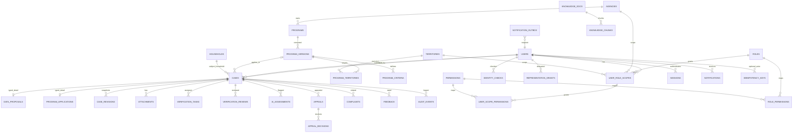
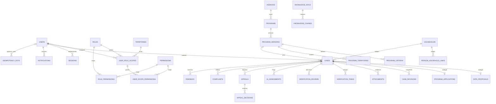

# BantuTepat — ERD & Data Dictionary

**Versi 1.2 | 26 November 2026 | Draft requirements, bukan bukti implementasi**

Acuan: Master Specification §6, §20.4 dan D05; PRD §10, §20. Baca `01_PRD.md` untuk scope, prioritas dan Open Decisions. Penomoran bagian yang diambil dari master dipertahankan. Kontrak v1.2 adalah kandidat freeze untuk persetujuan tim; sumber historis tidak mengungguli kontrak ini.

## 6. DATA MODEL DAN RELASI DATABASE

**Rekomendasi:** PostgreSQL managed + Prisma ORM untuk aplikasi Next.js. Database dikelola server-side; browser tidak mengakses schema administratif langsung. Jika memakai Supabase, tetap berlakukan RLS sesuai arsitektur akses; kunci elevated/service **tidak pernah masuk klien**.

### 6.1 Entitas wajib

| Tabel | Field penting (ringkas) | Indeks/constraint |
|---|---|---|
| `users` | id, email/phone verified, auth_provider_ref, status, created_at | unique normalized email; soft deactivate |
| `roles` | id, role_code | unique role_code |
| `permissions` | id, code | unique code |
| `user_role_scopes` | user_id, role_id, agency_id, territory_id, valid_from/to, approved_by | composite, expiry + revoked_at |
| `agencies` | id, name, agency_type, territory_scope, demo_flag | only synthetic in demo |
| `territories` | id, parent_id, level, code, name | unique code+level, hierarchical index |
| `households` | id, demo_household_key, self-reported attributes | data minimized |
| `person_household_links` | person_id, household_id, relation, verified_state | access proof |
| `representation_grants` | subject_id, representative_id, legal_basis_type, scope, expiry | revoke + evidence reference |
| `programs` | id, agency_id, slug, lifecycle_status, current_version_id | agency owner + unique slug |
| `program_versions` | id, program_id, version, name, policy_source, effective_at, mode, dates, address_basis, quota | immutable once published |
| `program_territories` | program_version_id, territory_id, include_descendants | composite unique |
| `program_criteria` | id, version_id, criterion_code, operator, value_json, source_document | strongly validated JSON schema |
| `cases` | id, ticket_no, type, subject_id, household_id, program_version_id nullable, submitter_id, source_channel, status, owner_agency_id, territory_id, version | unique ticket (nullable until submit); type-conditional checks |
| `data_proposals` | case_id, change_type, reason, household_snapshot | 1:1 case type enforced |
| `program_applications` | case_id, program_version_id, household_snapshot, application_snapshot | 1:1 case type enforced |
| `case_revisions` | case_id, revision_no, snapshot_json, submitted_at, submitted_by | unique case+revision, immutable after submit |
| `attachments` | id, case_id, object_key, sha256, mime, size, uploader_id, scan_status, classification | private access only |
| `verification_tasks` | id, case_id, assignee_id, stage, status, due_at | unique active assignment per stage |
| `verification_reviews` | id, case_id, actor_id, stage, decision, reason_code, notes, evidence_ref, rule_version_id | maker-checker enforced |
| `ai_assessments` | id, case_id, input_schema_version, model_version, status, flags_json, score nullable, human_feedback | only internal |
| `identity_checks` | id, user_id, method, decision, model_version, checked_at, retention_until, manual_ref | NEVER public biometrics |
| `appeals` | id, parent_case_id, challenged_review_id, submitter_id, reason, status, assignee, version, resolved_at | unique active appeal policy |
| `appeal_decisions` | id, appeal_id, reviewer_id, decision, reason, evidence_ref, timestamp | independent reviewer |
| `complaints` | id, related_case_id optional, confidential, category, owner, assignee_id, status, outcome, version | per-field access |
| `feedback` | id, case_id, citizen_id, score_1_5, category scores, comment | one feedback/version policy |
| `audit_events` | id, actor_id, entity_type, entity_id, action, before_hash, after_hash, reason_code, created_at, request_id | append-only; immutable role privileges |
| `notification_outbox` | id, event_id, recipient_id, channel, payload_ref, state, retries, next_attempt | unique event+channel+recipient |
| `wa_sessions` | id, phone_hash, wa_user_id_enc, state, selected_program_id, expires_at | TTL, max attempts |
| `integration_requests` | id, provider, correlation_id, request_meta_masked, status, retry_count | no raw identity secrets |
| `knowledge_docs` | id, title, official_url, doc_version, effective_date, approval_status, summary, created_by, approved_by, approved_at, version | versioned + approval |
| `knowledge_chunks` | id, knowledge_doc_id, chunk_text, embedding_ref, source_span | RAG public content only |
| `privacy_consents` | id, subject_id, purpose, legal_basis, captured_at, withdrawal_at | consent is not always sole lawful basis |
| `user_scope_permissions` | scope_id, permission_id, granted_by, valid_until, revoked_at | PK composite, FK scope + permission; elevated grants only |
| `role_permissions` | role_id, permission_id | PK composite; FK; GUEST tidak disimpan |
| `idempotency_keys` | actor_scope, actor_id nullable, idempotency_key, operation, request_hash, response_json, response_status, created_at, expires_at | PK (actor_scope, idempotency_key); actor_scope non-null namespaced user/service/WA; same canonical request replay; no raw PII |
| `notifications` | id, recipient_id, event_id, title, safe_body, created_at, read_at | unique event+recipient; recipient only |
| `sessions` | id, user_id, token_hash, encrypted_provider_tokens, csrf_hash, aal, expires_at, last_seen_at, revoked_at | token_hash unique; no raw tokens; session revocation |

### 6.2 Constraints utama (implementasi DB + domain policy)

1. `cases.type='DATA_PROPOSAL'` -> `program_version_id IS NULL`; `PROGRAM_APPLICATION` -> non-null.
2. `cases.ticket_no` unik, tidak berubah saat revisi, recheck, atau sanggahan.
3. `program_versions` published **immutable**; perubahan versi baru.
4. `verification_reviews.actor_id` untuk tahap final harus beda dari aktor pemeriksa awal / proposer keputusan kasus sama (maker-checker).
5. Pendaftaran program hanya untuk `program_version_id` yang `OPEN` menurut waktu server dan metode sah (atau sesuai review jika officer-only).
6. `status` berubah hanya lewat transition service, tidak boleh diedit langsung via `PATCH case` generik.
7. Idempotency key untuk create/submit dan webhook. Unique active case per program/household **jangan** menghapus hak klarifikasi; duplikasi mengembalikan tiket aktif dengan proses keberatan.
8. Semua relasi territory bersifat hirarkis dan mencatat jenis dasar alamat; tidak otomatis menolak hanya karena GPS berbeda.
9. Soft-delete PII sesuai kebijakan retensi dan kewajiban penyimpanan, tanpa menghapus bukti audit yang wajib; untuk demo, data boleh di-reset via seed script admin lokal.
10. `audit_events` append-only dengan DB privileges yang membatasi UPDATE/DELETE; teknik chain hash opsional (bukan pengganti pengamanan log).

### Diagram 05 — ERD konseptual

---

## ERD ringkas PRD dan usulan relasi pelengkap

### ERD ringkas

ERD ringkas bukan schema migrasi lengkap; gunakan daftar entitas dan constraints MS berikut dan diagram D05 untuk implementasi. Subtype case eksklusif, bukan dua subtype sekaligus.

### 6.1 Entitas wajib

| Tabel | Field penting (ringkas) | Indeks/constraint |
|---|---|---|
| `users` | id, email/phone verified, auth_provider_ref, status, created_at | unique normalized email; soft deactivate |
| `roles` | id, role_code | unique role_code |
| `permissions` | id, code | unique code |
| `user_role_scopes` | user_id, role_id, agency_id, territory_id, valid_from/to, approved_by | composite, expiry + revoked_at |
| `agencies` | id, name, agency_type, territory_scope, demo_flag | only synthetic in demo |
| `territories` | id, parent_id, level, code, name | unique code+level, hierarchical index |
| `households` | id, demo_household_key, self-reported attributes | data minimized |
| `person_household_links` | person_id, household_id, relation, verified_state | access proof |
| `representation_grants` | subject_id, representative_id, legal_basis_type, scope, expiry | revoke + evidence reference |
| `programs` | id, agency_id, slug, lifecycle_status, current_version_id | agency owner + unique slug |
| `program_versions` | id, program_id, version, name, policy_source, effective_at, mode, dates, address_basis, quota | immutable once published |
| `program_territories` | program_version_id, territory_id, include_descendants | composite unique |
| `program_criteria` | id, version_id, criterion_code, operator, value_json, source_document | strongly validated JSON schema |
| `cases` | id, ticket_no, type, subject_id, household_id, program_version_id nullable, submitter_id, source_channel, status, owner_agency_id, territory_id, version | unique ticket (nullable until submit); type-conditional checks |
| `data_proposals` | case_id, change_type, reason, household_snapshot | 1:1 case type enforced |
| `program_applications` | case_id, program_version_id, household_snapshot, application_snapshot | 1:1 case type enforced |
| `case_revisions` | case_id, revision_no, snapshot_json, submitted_at, submitted_by | unique case+revision, immutable after submit |
| `attachments` | id, case_id, object_key, sha256, mime, size, uploader_id, scan_status, classification | private access only |
| `verification_tasks` | id, case_id, assignee_id, stage, status, due_at | unique active assignment per stage |
| `verification_reviews` | id, case_id, actor_id, stage, decision, reason_code, notes, evidence_ref, rule_version_id | maker-checker enforced |
| `ai_assessments` | id, case_id, input_schema_version, model_version, status, flags_json, score nullable, human_feedback | only internal |
| `identity_checks` | id, user_id, method, decision, model_version, checked_at, retention_until, manual_ref | NEVER public biometrics |
| `appeals` | id, parent_case_id, challenged_review_id, submitter_id, reason, status, assignee, version, resolved_at | unique active appeal policy |
| `appeal_decisions` | id, appeal_id, reviewer_id, decision, reason, evidence_ref, timestamp | independent reviewer |
| `complaints` | id, related_case_id optional, confidential, category, owner, assignee_id, status, outcome, version | per-field access |
| `feedback` | id, case_id, citizen_id, score_1_5, category scores, comment | one feedback/version policy |
| `audit_events` | id, actor_id, entity_type, entity_id, action, before_hash, after_hash, reason_code, created_at, request_id | append-only; immutable role privileges |
| `notification_outbox` | id, event_id, recipient_id, channel, payload_ref, state, retries, next_attempt | unique event+channel+recipient |
| `wa_sessions` | id, phone_hash, wa_user_id_enc, state, selected_program_id, expires_at | TTL, max attempts |
| `integration_requests` | id, provider, correlation_id, request_meta_masked, status, retry_count | no raw identity secrets |
| `knowledge_docs` | id, title, official_url, doc_version, effective_date, approval_status, summary, created_by, approved_by, approved_at, version | versioned + approval |
| `knowledge_chunks` | id, knowledge_doc_id, chunk_text, embedding_ref, source_span | RAG public content only |
| `privacy_consents` | id, subject_id, purpose, legal_basis, captured_at, withdrawal_at | consent is not always sole lawful basis |
| `user_scope_permissions` | scope_id, permission_id, granted_by, valid_until, revoked_at | PK composite, FK scope + permission; elevated grants only |
| `role_permissions` | role_id, permission_id | PK composite; FK; GUEST tidak disimpan |
| `idempotency_keys` | actor_scope, actor_id nullable, idempotency_key, operation, request_hash, response_json, response_status, created_at, expires_at | PK (actor_scope, idempotency_key); actor_scope non-null namespaced user/service/WA; same canonical request replay; no raw PII |
| `notifications` | id, recipient_id, event_id, title, safe_body, created_at, read_at | unique event+recipient; recipient only |
| `sessions` | id, user_id, token_hash, encrypted_provider_tokens, csrf_hash, aal, expires_at, last_seen_at, revoked_at | token_hash unique; no raw tokens; session revocation |

### 6.2 Constraints utama (implementasi DB + domain policy)

1. `cases.type='DATA_PROPOSAL'` -> `program_version_id IS NULL`; `PROGRAM_APPLICATION` -> non-null.
2. `cases.ticket_no` unik, tidak berubah saat revisi, recheck, atau sanggahan.
3. `program_versions` published **immutable**; perubahan versi baru.
4. `verification_reviews.actor_id` untuk tahap final harus beda dari aktor pemeriksa awal / proposer keputusan kasus sama (maker-checker).
5. Pendaftaran program hanya untuk `program_version_id` yang `OPEN` menurut waktu server dan metode sah (atau sesuai review jika officer-only).
6. `status` berubah hanya lewat transition service, tidak boleh diedit langsung via `PATCH case` generik.
7. Idempotency key untuk create/submit dan webhook. Unique active case per program/household **jangan** menghapus hak klarifikasi; duplikasi mengembalikan tiket aktif dengan proses keberatan.
8. Semua relasi territory bersifat hirarkis dan mencatat jenis dasar alamat; tidak otomatis menolak hanya karena GPS berbeda.
9. Soft-delete PII sesuai kebijakan retensi dan kewajiban penyimpanan, tanpa menghapus bukti audit yang wajib; untuk demo, data boleh di-reset via seed script admin lokal.
10. `audit_events` append-only dengan DB privileges yang membatasi UPDATE/DELETE; teknik chain hash opsional (bukan pengganti pengamanan log).

Tambahkan `idempotency_keys` sesuai MS §20.4 (unique actor + key, payload hash dan response reference), serta tabel join role-permission dan relasi actor/subject yang diperlukan untuk mewujudkan kontrak. Nama dan field final disetujui pada phase 0; jangan menghapus constraint domain.

## Gate sebelum migrasi

- Diagram D05 adalah ERD konseptual, bukan schema Prisma yang dapat langsung dimigrasi.
- Tetapkan FK, tipe SQL, nullable/default, aturan delete/update, join role-permission, `idempotency_keys`, dan relasi tambahan tercantum pada ERD v1.2. Implementasi migrasi menyeluruh masih perlu validasi.
- Uji subtype eksklusif, immutable snapshot, audit append-only, scope dan maker-checker.
- Referensi visual: `03_ERD.drawio` (ekstrak halaman 5 dari diagram asli).

