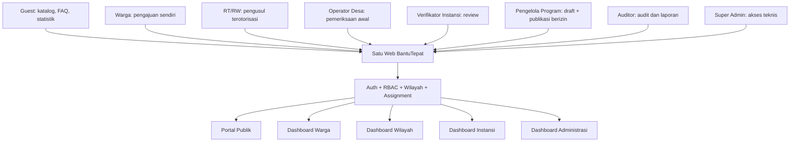

# BantuTepat — Role Matrix & Authorization

**Versi 1.2 | 26 November 2026 | Draft requirements, bukan bukti implementasi**

Acuan: Master Specification §3/D01; PRD §7, §20. Baca `01_PRD.md` untuk scope, prioritas dan Open Decisions. Penomoran bagian yang diambil dari master dipertahankan. Kontrak v1.2 adalah kandidat freeze untuk persetujuan tim; sumber historis tidak mengungguli kontrak ini.

## 7. Role dan authorization contract (MS §3)

### 3.1 Tabel role lengkap

| Kode role | Nama UI | Tugas | Yang boleh | Yang DILARANG / batasan | Dashboard |
|---|---|---|---|---|---|
| `GUEST` (konteks publik, bukan enum DB) | Pengunjung | melihat informasi publik | katalog, aturan, FAQ web LLM, transparansi agregat, kanal kontak | tidak lihat data privat, tidak submit identitas | Publik |
| `CITIZEN` | Masyarakat | menggunakan layanan dirinya/rumah tangga sesuai hak | usul/koreksi, daftar mode SELF/BOTH, tracking sendiri, resubmit, appeal, complaint, feedback | tidak lihat/edit milik warga lain, tidak ubah status/hasil | Warga |
| `REGIONAL_PROPOSER` | RT/RW terotorisasi | mengusulkan/mendampingi warga | buat usulan dengan perwakilan yang sah, lihat kasus sesuai mandat, memberi klarifikasi | tidak setujui, tidak lihat semua data warga, tidak usulkan luar scope | Wilayah |
| `VILLAGE_OPERATOR` | Operator desa/kelurahan | verifikasi tingkat awal sesuai mandat | ambil kasus ditugaskan, cek kelengkapan, minta revisi, rekomendasi | tidak memberi penetapan nasional; tidak review kasus yang sama pada tingkat akhir | Wilayah |
| `AGENCY_VERIFIER` | Verifikator instansi/Dinsos | tinjau hasil petugas dan sanggahan sesuai otorisasi | approve forwarding internal, minta recheck, close unprocessable with reason, review appeal berbeda penangan | tidak memutus status penerima resmi di luar mandat; tidak jadi maker & checker kasus sama | Instansi |
| `PROGRAM_MANAGER` | Pengelola program | siapkan kebijakan program yang sudah ada dari instansi | create/edit draft, territory, mode, quota, ketentuan, submit publication review; publish hanya jika punya permission `program.publish` | tidak buat program luar mandat; tidak publish sendiri tanpa otorisasi; tidak ubah hasil kasus | Instansi |
| `AUDITOR` | Pengawas/auditor | memantau kepatuhan dan kinerja | dashboard KPI, audit timeline, laporan dan eskalasi sesuai mandat | tidak manipulasi log, tidak menerima/menolak pengajuan tanpa kewenangan tambahan | Administrasi |
| `SUPER_ADMIN` | Super Admin Teknis | kelola user, izin dan keamanan | invite/revoke role, scope/masa berlaku, setting, health/operasional | **bukan pejabat penentu penerima**, tidak mengubah keputusan diam-diam, tidak bisa akses berkas privat tanpa mandat kasus | Administrasi |

**Group dashboard:** 4 + publik: `/dashboard` warga; `/wilayah` proposer/operator; `/instansi` verifier/program manager; `/administrasi` auditor/superadmin. Route UI hanya convenience. Izin selalu divalidasi ulang server-side.

### 3.2 Matriks hak akses (`A`=create; `R`=read assigned; `V`=verify/review; `P`=publish with separate permission; `-`=none)

| Kapabilitas | Guest | Warga | RT | Operator | Verifikator | Program mgr | Auditor | Super Admin |
|---|---|---|---|---|---|---|---|---|
| Baca katalog publik | ✓ | ✓ | ✓ | ✓ | ✓ | ✓ | ✓ | ✓ |
| Chatbot RAG publik | ✓ | ✓ | ✓ | ✓ | ✓ | ✓ | ✓ | ✓ |
| Data proposal milik sendiri | - | A/R | - | - | - | - | R* | - |
| Usulkan warga diberi mandat | - | - | A/R | A/R* | - | - | - | - |
| Pendaftaran program SELF | - | A/R | - | - | - | - | - | - |
| Pendaftaran via petugas | - | - | A/R* | A/R* | - | - | - | - |
| Verifikasi awal | - | - | - | V/R | - | - | R* | - |
| Review & tindak lanjut | - | - | - | - | V/R | - | R* | - |
| Draft program | - | - | - | - | - | A/R | R* | - |
| Publish program | - | - | - | - | - | P* | R* | - |
| Sanggahan kasus sendiri | - | A/R | A/R* | - | V/R* | - | R* | - |
| Audit read sesuai scope | - | Timeline sendiri | Timeline usulan | Timeline tugas | Timeline tugas | Timeline program | R | Access-log teknis |
| Admin user/role | - | - | - | - | - | - | - | A/R |

`*` = hanya bila mandat, kewenangan objek, instansi, wilayah, status, dan/atau assignment sesuai. Hak audit bersifat read-only. Publication reviewer harus **pengguna berbeda** dari pengusul draft, menggunakan permission eksplisit `program.publish`.

### 3.3 Permission codes kanonik v1.2

`program.read_public`, `program.draft.create`, `program.draft.update`, `program.submit_review`, `program.publish`, `program.archive`, `case.create.self`, `case.create.represented`, `case.read.own`, `case.read.assigned`, `case.revise.own`, `case.verify.assigned`, `case.review.assigned`, `case.appeal.own`, `appeal.review.independent`, `complaint.create`, `complaint.manage.assigned`, `audit.read.scoped`, `metrics.read.public`, `metrics.read.internal`, `users.manage_roles`, `integration.manage`, `ai.assessment.read.scoped`, `case.assign`, `appeal.assign`, `case.attachment.write`, `case.attachment.read`, `complaint.read.own`, `complaint.assign`, `notification.read.own`, `representation.manage`, `territory.manage`, `knowledge.approve`, `knowledge.draft.create`, `representation.approve`.

**Role model:** 7 role terautentikasi; GUEST adalah konteks tanpa akun, tidak disimpan dalam roles/user_role_scopes. SYSTEM adalah principal layanan, bukan role. Grant khusus tidak otomatis diberikan kepada SUPER_ADMIN.

**Policy check** = `isAuthenticated && hasPermission && inJurisdiction && assignedOrOwner && statusAllowsAction && separationOfDuties && mandateActive`. Terapkan query filtering dan object check, bukan sekadar cek menu/route; semua mutasi terhubung user ID, agency ID, scope ID, version ID. Petugas yang mengajukan atas nama warga harus menyimpan `submitted_by_actor_id != subject_user_id` dan bukti dasar perwakilan.

## Diagram hierarchy

### Diagram 01 — Role hierarchy dan hubungan tugas

---

## Catatan pengujian

Matriks tidak memberi akses global: setiap A/R/V/P dibatasi policy server. Pastikan permission yang belum eksplisit (complaint, assignment, representation grant) diputuskan pada Phase 0; jangan memberi akses default. Lihat T-02, T-12, T-13, T-17, T-29, T-30, T-42.

## Kebijakan grant dan akses tambahan v1.2

| Permission | Pemegang yang dapat ditugaskan (grant eksplisit, scoped) | Batasan |
|---|---|---|
| `program.publish`, `program.archive` | PROGRAM_MANAGER | publisher berbeda dari maker; archive hanya closed |
| `case.assign`, `appeal.assign` | AGENCY_VERIFIER coordinator | hanya wilayah/instansi sah; tidak assign diri |
| `case.attachment.read/write` | CITIZEN/REGIONAL_PROPOSER/VILLAGE_OPERATOR/AGENCY_VERIFIER sesuai tugas | owner/mandate/assigned, state dan purpose; auditor tidak otomatis baca file |
| `complaint.read.own`, `complaint.create` | CITIZEN | milik sendiri; guest tidak bisa submit |
| `complaint.manage.assigned`, `complaint.assign` | AGENCY_VERIFIER atau AUDITOR yang diberi mandat penanganan keluhan terpisah | scope, confidentiality; hak penanganan bukan hak penetapan bansos |
| `notification.read.own` | semua role terautentikasi | recipient only |
| `representation.manage`, `representation.approve`, `territory.manage` | SUPER_ADMIN dengan mandat | pembuat grant berbeda dari penyetuju, tidak boleh self grant |
| `knowledge.draft.create`, `knowledge.approve` | SUPER_ADMIN atau PROGRAM_MANAGER dengan mandat knowledge | reviewer berbeda; approved public docs only |

Base role permissions di `role_permissions`; elevated permissions di `user_scope_permissions` dengan expiry/revocation. Pemberian role atau izin tidak boleh self-escalate; `program.publish` bukan enum role atau alias string.
