# BantuTepat — Business Workflow & State Machines

**Versi 1.2 | 26 November 2026 | Draft requirements, bukan bukti implementasi**

Acuan: Master Specification §7–15, §17; PRD §9, §20. Baca `01_PRD.md` untuk scope, prioritas dan Open Decisions. Penomoran bagian yang diambil dari master dipertahankan. Kontrak v1.2 adalah kandidat freeze untuk persetujuan tim; sumber historis tidak mengungguli kontrak ini.

## 9. Business workflow dan rules

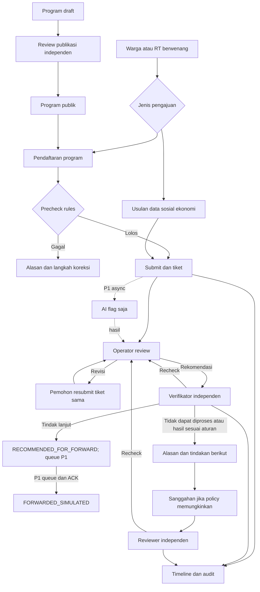

Pengaduan dan feedback adalah objek terpisah dari diagram keputusan; pengaduan ditriase dan ditangani oleh petugas bermandat, feedback tidak memengaruhi eligibility. Semua transisi bisnis penting mencatat audit. Diagram visual penuh: MS D06–D12 dan D18–D19.

### 8.1 Field konfigurasi program yang WAJIB

| Field | Makna | Contoh demo | Validasi |
|---|---|---|---|
| Pemilik program | instansi penyelenggara | Dinsos Kab. Semarang **fiktif** | harus sesuai mandate actor |
| Nama dan kode program | identitas unik | Bantuan Pangan Kab A / `BP-KABA-2026` | unique per agency/version |
| Dokumen/URL aturan | dasar kebijakan yang dapat dirujuk | dokumen **simulasi** | wajib terisi sebelum publish |
| Mode pendaftaran | `SELF`, `OFFICER_ONLY`, `BOTH`, `NO_PUBLIC_REGISTRATION` | `BOTH` | nilai enum sah dan dasar aturan |
| Cakupan | prov/kab/kec/desa atau nasional | Kab Semarang (demo) | subset kewenangan instansi |
| Jenis alamat | KTP/domisili sesuai aturan program | domisili (demo) | tidak berdasarkan GPS saja |
| Status program | draft, approval, live, closed | DRAFT | mesin status |
| Periode program | pengumuman & pendaftaran | 1–15 Des 2026 (demo) | start <= end; timezone konsisten |
| Kriteria | requirement data/kuota/peruntukan | contoh syarat dokumen | memiliki tipe, operator, dasar |
| Dokumen wajib | jenis, batas ukuran, retensi | dokumen pendukung fiktif | file validation dan private storage |
| Kuota | optional, bila sah | 100 (demo) | cap tidak menyiratkan auto-seleksi |
| Alur verifikasi | petugas wilayah → instansi | `VILLAGE_OPERATOR` → `AGENCY_VERIFIER` | mengikuti kebijakan program |
| Masa sanggah | rentang jika memang dibuka | 7 hari (hanya demo; configurable) | jangan klaim standar resmi seragam |
| SLA | target layanan per program | 3 hari kerja (demo) | konfigurasi, tidak klaim resmi |
| Persetujuan publikasi | mandatory reviewer | pemegang `program.publish` | maker != publisher |

### 8.2 Aturan program lifecycle

- `DRAFT`: boleh diubah oleh Program Manager berwenang.
- `PENDING_PUBLICATION_REVIEW`: pengelola submit; draft terkunci hingga keputusan reviewer.
- `RETURNED_FOR_REVISION`: dikembalikan dengan alasan; diajukan ulang.
- `APPROVED`: disetujui; publikasi sesuai waktu/tindakan pengesahan.
- `PUBLISHED`: tersedia untuk dibaca publik; belum tentu membuka pendaftaran.
- `OPEN`: `PUBLISHED` dan periode pendaftaran aktif serta mode != NO_PUBLIC_REGISTRATION.
- `CLOSED`: pengajuan baru tutup; pengajuan lama masih diproses.
- `ARCHIVED`: historis publik tetap bisa dirujuk; rule snapshot tidak hilang.

### 10.1 Penentuan cara daftar per program

| `registration_mode` | Warga mandiri | RT/Operator | UI warga |
|---|---|---|---|
| `SELF` | Bisa sesuai rules program | tidak, kecuali hak/perwakilan resmi khusus | “Daftar Sekarang” |
| `OFFICER_ONLY` | Tidak untuk jalur web langsung | Bisa sesuai penugasan | “Lihat prosedur melalui petugas” |
| `BOTH` | Bisa | Bisa | opsi jalur: ajukan sendiri / dibantu |
| `NO_PUBLIC_REGISTRATION` | Tidak | tidak via pendaftaran terbuka; bila ada proses internal resmi perlu workflow tersendiri | “Informasi Program & Mekanisme Resmi” |

### 10.2 Precheck **bukan keputusan kelayakan akhir**

- Program diterbitkan dan status open; tanggal sesuai waktu server; mode sesuai role.
- Pemohon/rumah tangga berada dalam wilayah sasaran menurut **basis alamat program** (data kependudukan/domisili sesuai aturan simulasi). Pastikan *teritori* bukan sekadar lokasi IP/GPS.
- Persyaratan format, field minimum, lampiran, satu pengajuan aktif bila sesuai aturan.
- Jika gagal precheck, tampilkan `blocked_reason_code` dan langkah koreksi (ubah informasi yang memang salah / pilih kanal sesuai program). **Jangan labeli "bansos ditolak"** karena kasus belum diajukan.
- Setelah submit, rules dan AI menandai masalah; petugas melakukan verifikasi, verifikator memutus tindak lanjut yang berwenang.
- Kuota habis: bukan otomatis kecurangan. Gunakan status `NOT_SELECTED` **hanya bila aturan resmi program memungkinkan seleksi, keputusan diberikan pihak berwenang, dan alasannya terdokumentasi**. Dalam demo jelas berlabel simulasi.

### 12.1–12.2 Status kasus (kanonik, kedua tipe)

`DRAFT → SUBMITTED → PRECHECKED → UNDER_REVIEW → PENDING_APPROVAL → RECOMMENDED_FOR_FORWARD`.

- `SUBMITTED → PRECHECKED` mencatat hasil pemeriksaan valid yang sudah dilakukan server saat submit. Data proposal memeriksa kelengkapan dan mandat, bukan eligibility program. Submit invalid tetap DRAFT/REVISION_REQUIRED dan 422; tidak menciptakan tiket baru. Kedua event dicatat dalam transaksi submit; respons akhir `PRECHECKED`.
- Revisi: `UNDER_REVIEW → REVISION_REQUIRED → RESUBMITTED → UNDER_REVIEW` (resubmission + revalidation atomik; response `UNDER_REVIEW`). Recheck: `PENDING_APPROVAL → UNDER_REVIEW`.
- P0 berhenti pada `RECOMMENDED_FOR_FORWARD` (hasil internal); P1 `RECOMMENDED_FOR_FORWARD → FORWARDING_PENDING → FORWARDED_SIMULATED` atau `FORWARDING_FAILED → FORWARDING_PENDING` untuk retry. `CLOSED_UNPROCESSABLE` tersedia bagi kedua tipe; `NOT_SELECTED` hanya program dengan aturan dan kewenangan sah.
- `CLOSED` hanya dari hasil terminal yang diizinkan dalam tabel; kegagalan forwarding tidak menjadi sukses atau ditutup diam-diam. Status hasil sebelum penutupan tetap tersimpan pada decision/timeline.

### 12.3 Status sanggahan

`APPEAL_SUBMITTED → APPEAL_REVIEW → UPHELD | RECHECK_REQUIRED | DECISION_CORRECTED → APPEAL_CLOSED`. Objek terpisah. Appeal hanya terhadap `CLOSED_UNPROCESSABLE` atau `NOT_SELECTED` yang eligible; satu aktif per kasus; waktu sanggah berasal dari policy versi. Koreksi/recheck membuka tugas baru, tidak menimpa keputusan lama. Tidak ada reopening bebas setelah CLOSED.

### 12.4 Status pengaduan/feedback

`RECEIVED → TRIAGED → ASSIGNED → IN_HANDLING → RESOLVED | REFERRED → CLOSED`. Guest tidak submit pengaduan dalam MVP. Feedback `SUBMITTED`, tidak mengubah eligibility.

### 12.5 Invariant transition

Single source of truth: `phase0/packages/policy/transitions.ts` dan `phase0/STATE_CONTRACT.md`. Default deny; setiap mutasi memeriksa aktor, izin, scope, assignment, mandat aktif, maker-checker, status dan expected version. Audit/decision/revision/outbox atomik. Tidak ada PATCH status generik. SYSTEM bukan role akun; hanya service internal yang terotorisasi. Semua tabel di bawah/diagram mengikuti kontrak ini.


## Workflow lengkap dari master (diagram Mermaid)

## 7. MASTER BUSINESS WORKFLOW — SEMUA JALUR

### Diagram 06 — Master proses end-to-end (dari program sampai feedback)

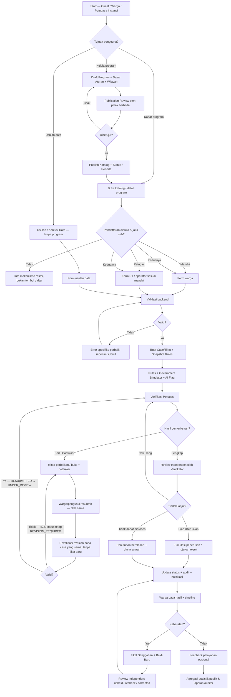

**Penjelasan:** `NO_PUBLIC_REGISTRATION` tidak berarti warga dilarang melakukan *usulan data* terpisah melalui kanal yang sah. `DEN` adalah hasil administratif berdasar aturan dan manusia berwenang; AI **tidak** dapat langsung mengeluarkan `DEN`.

---

## 8. WORKFLOW PEMBUATAN PROGRAM (PEMERINTAH/INSTANSI)

### 8.1 Field konfigurasi program yang WAJIB

| Field | Makna | Contoh demo | Validasi |
|---|---|---|---|
| Pemilik program | instansi penyelenggara | Dinsos Kab. Semarang **fiktif** | harus sesuai mandate actor |
| Nama dan kode program | identitas unik | Bantuan Pangan Kab A / `BP-KABA-2026` | unique per agency/version |
| Dokumen/URL aturan | dasar kebijakan yang dapat dirujuk | dokumen **simulasi** | wajib terisi sebelum publish |
| Mode pendaftaran | `SELF`, `OFFICER_ONLY`, `BOTH`, `NO_PUBLIC_REGISTRATION` | `BOTH` | nilai enum sah dan dasar aturan |
| Cakupan | prov/kab/kec/desa atau nasional | Kab Semarang (demo) | subset kewenangan instansi |
| Jenis alamat | KTP/domisili sesuai aturan program | domisili (demo) | tidak berdasarkan GPS saja |
| Status program | draft, approval, live, closed | DRAFT | mesin status |
| Periode program | pengumuman & pendaftaran | 1–15 Des 2026 (demo) | start <= end; timezone konsisten |
| Kriteria | requirement data/kuota/peruntukan | contoh syarat dokumen | memiliki tipe, operator, dasar |
| Dokumen wajib | jenis, batas ukuran, retensi | dokumen pendukung fiktif | file validation dan private storage |
| Kuota | optional, bila sah | 100 (demo) | cap tidak menyiratkan auto-seleksi |
| Alur verifikasi | petugas wilayah → instansi | `VILLAGE_OPERATOR` → `AGENCY_VERIFIER` | mengikuti kebijakan program |
| Masa sanggah | rentang jika memang dibuka | 7 hari (hanya demo; configurable) | jangan klaim standar resmi seragam |
| SLA | target layanan per program | 3 hari kerja (demo) | konfigurasi, tidak klaim resmi |
| Persetujuan publikasi | mandatory reviewer | pemegang `program.publish` | maker != publisher |

### 8.2 Aturan program lifecycle

- `DRAFT`: boleh diubah oleh Program Manager berwenang.
- `PENDING_PUBLICATION_REVIEW`: pengelola submit; draft terkunci hingga keputusan reviewer.
- `RETURNED_FOR_REVISION`: dikembalikan dengan alasan; diajukan ulang.
- `APPROVED`: disetujui; publikasi sesuai waktu/tindakan pengesahan.
- `PUBLISHED`: tersedia untuk dibaca publik; belum tentu membuka pendaftaran.
- `OPEN`: `PUBLISHED` dan periode pendaftaran aktif serta mode != NO_PUBLIC_REGISTRATION.
- `CLOSED`: pengajuan baru tutup; pengajuan lama masih diproses.
- `ARCHIVED`: historis publik tetap bisa dirujuk; rule snapshot tidak hilang.

### Diagram 07 — Workflow Program Management

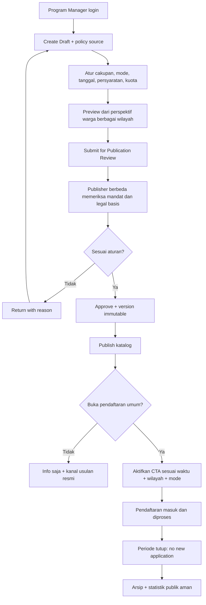

**Frontend wajib menguji:** program nasional vs kabupaten vs desa; `OFFICER_ONLY` bukan menampilkan tombol daftar untuk warga; `NO_PUBLIC_REGISTRATION` hanya info, bukan 403 diam-diam; periode belum buka/tutup; program versi revisi; pembuat draft gagal publish sendiri.

---

## 9. WORKFLOW USULAN DATA SOSIAL EKONOMI (TANPA PROGRAM)

### 9.1 Jalur pemohon

- **Mandiri melalui web:** warga mendaftar/login, membaca perlindungan data, membuat usulan/koreksi, mendapat tiket dan memantau.
- **Diwakili RT/Operator:** akun terotorisasi membuat usulan atas nama warga yang benar dalam scope wilayah serta mencatat dasar perwakilan; warga dapat melihat/mengoreksi kasus setelah keterkaitan dan akses dibuktikan.
- **WhatsApp statis:** hanya membuat draf awal tanpa identitas sensitif; selesaikan di web aman.

### 9.2 Form usulan data — minimum yang layak

`jenis_usulan: BELUM_TERDATA | PERBAIKAN | PERUBAHAN_KONDISI`, data kontak, identitas akun dengan pengumpulan minimum, household ID internal, wilayah administratif relevan, informasi anggota keluarga yang dibutuhkan, rentang/perubahan kondisi ekonomi yang relevan, alasan, dokumen pendukung yang benar-benar perlu, pernyataan kebenaran data dan privacy notice. Data biometrik **tidak perlu** dikumpulkan secara default.

### Diagram 08 — Data Proposal, sukses, revisi, tidak dapat diproses

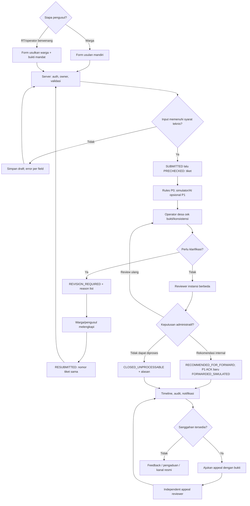

**Batas keputusan:** masyarakat boleh membuat *usulan ke BantuTepat*, tetapi ini tidak sama dengan mengajukan langsung ke aplikasi resmi Kemensos; status penerusan nyata memerlukan integrasi resmi. Jangan mengubah kolom `dtsen_status` menjadi "accepted" dari AI/aksi aplikasi demo.

---

## 10. WORKFLOW PENDAFTARAN PROGRAM SPESIFIK

### 10.1 Penentuan cara daftar per program

| `registration_mode` | Warga mandiri | RT/Operator | UI warga |
|---|---|---|---|
| `SELF` | Bisa sesuai rules program | tidak, kecuali hak/perwakilan resmi khusus | “Daftar Sekarang” |
| `OFFICER_ONLY` | Tidak untuk jalur web langsung | Bisa sesuai penugasan | “Lihat prosedur melalui petugas” |
| `BOTH` | Bisa | Bisa | opsi jalur: ajukan sendiri / dibantu |
| `NO_PUBLIC_REGISTRATION` | Tidak | tidak via pendaftaran terbuka; bila ada proses internal resmi perlu workflow tersendiri | “Informasi Program & Mekanisme Resmi” |

### 10.2 Precheck **bukan keputusan kelayakan akhir**

- Program diterbitkan dan status open; tanggal sesuai waktu server; mode sesuai role.
- Pemohon/rumah tangga berada dalam wilayah sasaran menurut **basis alamat program** (data kependudukan/domisili sesuai aturan simulasi). Pastikan *teritori* bukan sekadar lokasi IP/GPS.
- Persyaratan format, field minimum, lampiran, satu pengajuan aktif bila sesuai aturan.
- Jika gagal precheck, tampilkan `blocked_reason_code` dan langkah koreksi (ubah informasi yang memang salah / pilih kanal sesuai program). **Jangan labeli "bansos ditolak"** karena kasus belum diajukan.
- Setelah submit, rules dan AI menandai masalah; petugas melakukan verifikasi, verifikator memutus tindak lanjut yang berwenang.
- Kuota habis: bukan otomatis kecurangan. Gunakan status `NOT_SELECTED` **hanya bila aturan resmi program memungkinkan seleksi, keputusan diberikan pihak berwenang, dan alasannya terdokumentasi**. Dalam demo jelas berlabel simulasi.

### Diagram 09 — Pendaftaran, batas wilayah & penolakan dua tahap

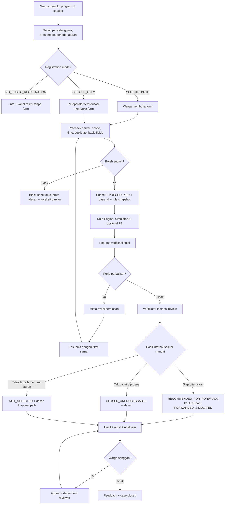

---

## 11. USER FLOW DETIL PER PERSONA

### 11.1 Warga mandiri — contoh lengkap kasus **ditolak**

1. Guest melihat program bantuan Kab A; login warga dengan domisili Kab A.
2. Klik “Daftar Sekarang” (tersedia karena program `SELF/BOTH`, `OPEN`, dan wilayah sesuai).
3. Wizard 3–4 langkah: data pokok → kondisi yang relevan → berkas → review/konfirmasi.
4. Submit -> `BT-P-2026-0007`; tampilkan tiket dan `PRECHECKED` (event SUBMITTED tersimpan).
5. Server rule memeriksa; AI flag "perubahan pendapatan butuh konfirmasi"; petugas **tidak otomatis menolak**.
6. Petugas meminta dokumen tambahan dengan daftar alasan -> `REVISION_REQUIRED`.
7. Warga menambah bukti -> `RESUBMITTED` lalu `UNDER_REVIEW`, tiket tetap.
8. Petugas rekomendasikan kasus lengkap; verifikator melihat dokumen dan alasan serta mengambil keputusan berotorisasi.
9. Contoh demo: verifikator memutus `CLOSED_UNPROCESSABLE` karena kriteria administratif tertentu tidak dipenuhi **setelah pemeriksaan**; alasan, dasar program, tanggal, dan jalur keberatan tampak.
10. Warga klik “Ajukan Sanggahan”, masukkan alasan dan bukti yang belum diperiksa; muncul tiket appeal `BT-A-2026-001` terhubung kasus induk.
11. Reviewer appeal independen dapat `UPHELD`, `RECHECK_REQUIRED`, atau `DECISION_CORRECTED`; jika recheck, kasus induk kembali ke antrean dengan event jelas.
12. Warga melihat hasil appeal dan mengisi feedback kepuasan; auditor melihat metrik agregat dan event yang diizinkan.

**Contoh kata-kata UI hasil negatif (bukan auto-kecurangan):**

> "Pengajuan Anda belum dapat diproses lebih lanjut. Alasan: [ketentuan administratif spesifik]. Dasar: [nama aturan program + versi/tanggal]. Anda dapat [memperbaiki/mengajukan sanggahan/menghubungi petugas] sesuai ketentuan program. Hasil ini merupakan simulasi penanganan BantuTepat dan bukan keputusan bantuan resmi."

### 11.2 RT/RW mengusulkan warga

1. RT login, role + wilayah ditentukan administrator; *scope* tidak dipilih bebas oleh RT.
2. Klik `Usulkan Warga`, pilih program yang membuka `OFFICER_ONLY/BOTH` atau `Usulan Data`.
3. Isi identitas subjek dengan data minimum dan dasar mandat/perwakilan, lalu bukti.
4. Jika warga di luar wilayah petugas -> 403/422 beralasan tanpa mengungkap data lengkap warga.
5. Buat tiket `submitted_by=RT`, `subject=warga`, `source_channel=OFFICER`.
6. Warga diberi akses setelah keterkaitan diverifikasi dan dapat melihat status/menyanggah; RT hanya memantau kasus yang menjadi tugasnya.
7. Operator desa memeriksa, verifikator berbeda meninjau; RT tidak boleh auto-approve.

### 11.3 Operator desa/kelurahan

1. Buka antrean kasus **assigned/scope** dengan filter dan indikator AI.
2. Buka detail; lihat data seminimal mungkin, checklist dokumen, status rules/AI disertai provenance.
3. Lakukan verifikasi manual; boleh minta revisi, minta klarifikasi, atau membuat rekomendasi tindak lanjut.
4. Setiap tindakan wajib `reason_code`, catatan dan bukti rujukan; timeline tersimpan.
5. Tidak boleh memberikan final review pada kasus yang diperiksanya.

### 11.4 Verifikator instansi/Dinsos

1. Lihat `PENDING_APPROVAL`; ambil kasus dalam scope instansi/wilayah, bukan semua daerah.
2. Sistem validasi `reviewer != initial_verifier` dan konflik kepentingan lain.
3. Lihat snapshot rules, hasil manual dan AI flag (bukan menjadikan skor satu-satunya alasan).
4. Tindak lanjut: minta ulang, rekomendasi internal (P1 forwarding simulasi), atau tutup beralasan sesuai kebijakan; tidak menerbitkan klaim penerima resmi.
5. Sanggahan ditinjau reviewer lain yang independen dari keputusan awal.

### 11.5 Pengelola program

1. Buat program dengan dasar aturan, versi, cakupan dan mode yang ditugaskan.
2. Preview kondisi warga A/B, tanggal/territory edge cases.
3. Ajukan review; hanya publisher berbeda yang dapat menyetujui publikasi.
4. Setelah diterbitkan, semua kasus baru menyimpan rule snapshot versi yang berlaku.
5. Edit program yang telah publish harus menjadi **versi baru**, bukan menimpa histori.

### 11.6 Pengawas/Auditor

1. Masuk dashboard pengawasan terotorisasi.
2. Monitor waktu antrean, alasan penolakan, tingkat kasus revisi, indikator keterlambatan, distribusi per wilayah yang aman.
3. Drill down kasus **hanya sesuai mandat**, lihat event actor/timestamp/reason, tidak bisa mengedit event.
4. Kelola rujukan pengaduan, eskalasi potensi penyimpangan sesuai kewenangan.

### 11.7 Super Admin teknis

1. Undang petugas dan hubungkan role/scope dengan masa berlaku; tidak ada self-register admin.
2. Nonaktifkan pengguna, cabut mandat, rotasi rahasia integrasi, lihat health service.
3. Tidak boleh menggunakan panel admin untuk mengubah status bantuan atau melihat dokumen warga tanpa alasan akses yang sah.
4. Audit setiap privilege change dan akses khusus.

### Diagram 10 — Swimlane user flow (empat lapisan proses)

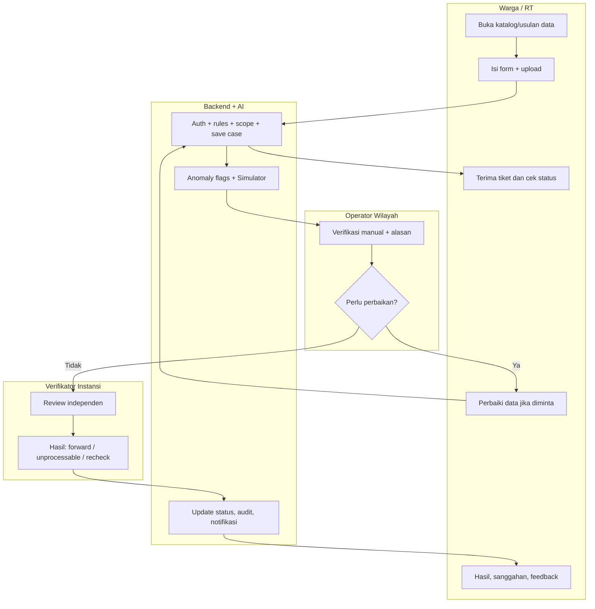

---

## 12. STATUS, TRANSISI, INVARIANT (IMPLEMENT STATE MACHINES)

**Catatan:** hindari `status` bertumpuk yang memiliki makna ambigu. Gunakan `case.type`, `case.state`, `review_stage`, `external_integration_state`, dan `appeal.state` terpisah.

### 12.1–12.2 Status kasus (kanonik, kedua tipe)

`DRAFT → SUBMITTED → PRECHECKED → UNDER_REVIEW → PENDING_APPROVAL → RECOMMENDED_FOR_FORWARD`.

- `SUBMITTED → PRECHECKED` mencatat hasil pemeriksaan valid yang sudah dilakukan server saat submit. Data proposal memeriksa kelengkapan dan mandat, bukan eligibility program. Submit invalid tetap DRAFT/REVISION_REQUIRED dan 422; tidak menciptakan tiket baru. Kedua event dicatat dalam transaksi submit; respons akhir `PRECHECKED`.
- Revisi: `UNDER_REVIEW → REVISION_REQUIRED → RESUBMITTED → UNDER_REVIEW` (resubmission + revalidation atomik; response `UNDER_REVIEW`). Recheck: `PENDING_APPROVAL → UNDER_REVIEW`.
- P0 berhenti pada `RECOMMENDED_FOR_FORWARD` (hasil internal); P1 `RECOMMENDED_FOR_FORWARD → FORWARDING_PENDING → FORWARDED_SIMULATED` atau `FORWARDING_FAILED → FORWARDING_PENDING` untuk retry. `CLOSED_UNPROCESSABLE` tersedia bagi kedua tipe; `NOT_SELECTED` hanya program dengan aturan dan kewenangan sah.
- `CLOSED` hanya dari hasil terminal yang diizinkan dalam tabel; kegagalan forwarding tidak menjadi sukses atau ditutup diam-diam. Status hasil sebelum penutupan tetap tersimpan pada decision/timeline.

### 12.3 Status sanggahan

`APPEAL_SUBMITTED → APPEAL_REVIEW → UPHELD | RECHECK_REQUIRED | DECISION_CORRECTED → APPEAL_CLOSED`. Objek terpisah. Appeal hanya terhadap `CLOSED_UNPROCESSABLE` atau `NOT_SELECTED` yang eligible; satu aktif per kasus; waktu sanggah berasal dari policy versi. Koreksi/recheck membuka tugas baru, tidak menimpa keputusan lama. Tidak ada reopening bebas setelah CLOSED.

### 12.4 Status pengaduan/feedback

`RECEIVED → TRIAGED → ASSIGNED → IN_HANDLING → RESOLVED | REFERRED → CLOSED`. Guest tidak submit pengaduan dalam MVP. Feedback `SUBMITTED`, tidak mengubah eligibility.

### 12.5 Invariant transition

Single source of truth: `phase0/packages/policy/transitions.ts` dan `phase0/STATE_CONTRACT.md`. Default deny; setiap mutasi memeriksa aktor, izin, scope, assignment, mandat aktif, maker-checker, status dan expected version. Audit/decision/revision/outbox atomik. Tidak ada PATCH status generik. SYSTEM bukan role akun; hanya service internal yang terotorisasi. Semua tabel di bawah/diagram mengikuti kontrak ini.


### Diagram 11 — State machine cases dan appeal (v1.2)

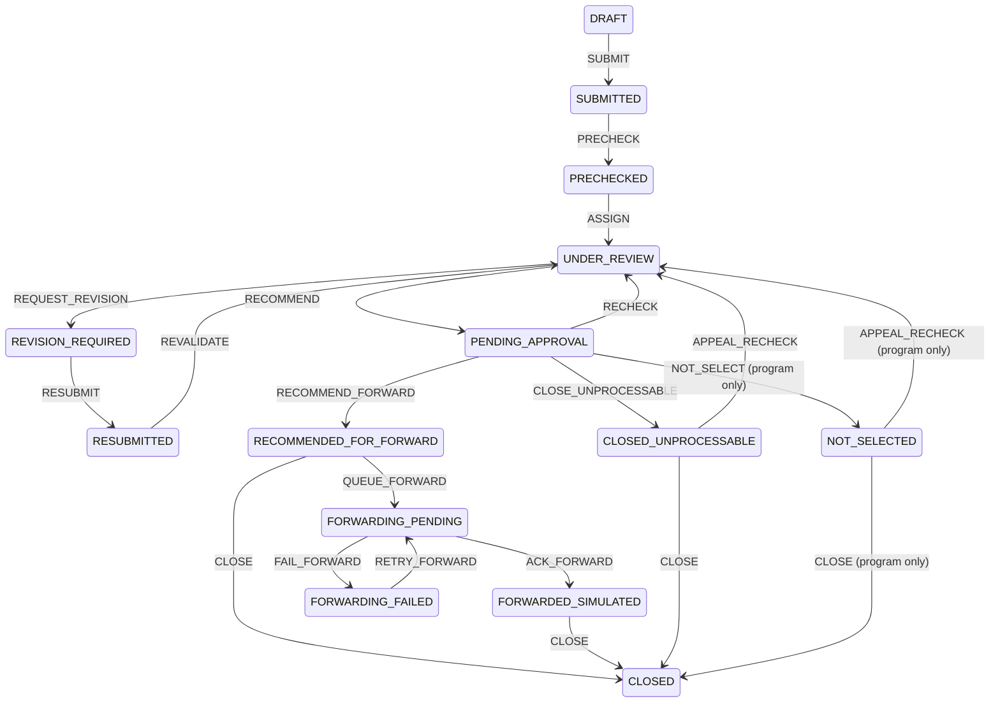

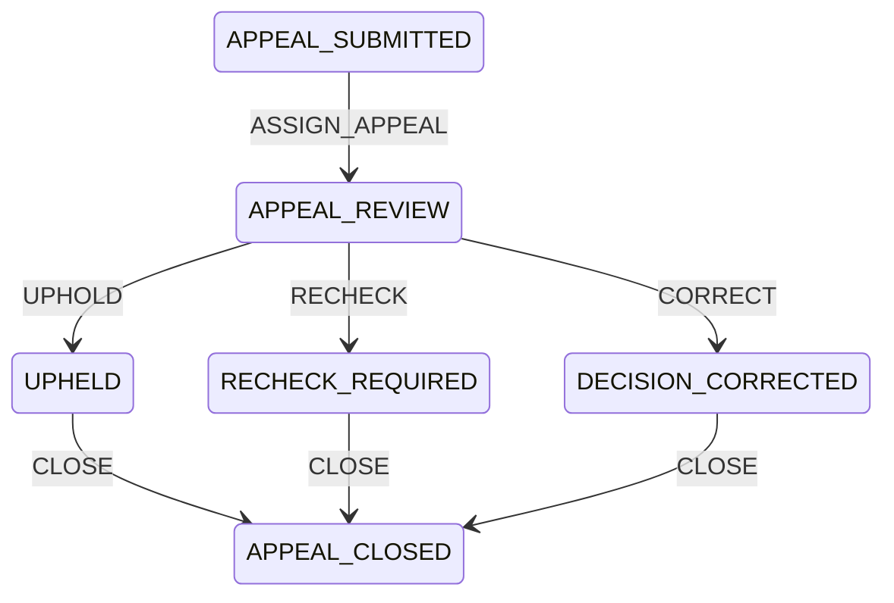


---

## 13. SANGGAHAN, PENGADUAN, FEEDBACK, TRANSPARANSI DAN AKUNTABILITAS

### 13.1 Bedakan saluran hasil kasus

| Proses | Trigger | Siapa memutus/menangani | Hasil dan audit |
|---|---|---|---|
| **Perbaikan** | formulir kurang lengkap, perlu bukti | pemohon menambah, petugas cek ulang | resubmit tiket sama |
| **Sanggahan** | warga keberatan atas hasil administratif | reviewer independen sesuai kewenangan | uphold/recheck/correct + reason |
| **Pengaduan** | layanan lambat, pungutan, penyalahgunaan, akses bermasalah | petugas pengaduan/pengawas ditugaskan | received → handled/referred; kerahasiaan |
| **Feedback** | selesai layanan | tidak untuk memutus kasus | rating kepuasan dan tindak lanjut kualitas |

### 13.2 Desain pengalaman sanggahan

- Link hanya muncul jika program/jalur menyediakan mekanisme sesuai aturan, atau sediakan penjelasan kanal keberatan resmi bila BantuTepat tidak berwenang.
- Form mencakup `parent_case_id`, alasan kategori, uraian, evidence attachment; jangan mewajibkan seluruh formulir awal diulang.
- Review oleh user berbeda dari reviewer keputusan awal; jika tidak ada reviewer memenuhi separation-of-duties, **eskalasi**, jangan bypass.
- Hasil harus menjelaskan **apa yang diperiksa**, **apa yang berubah**, **mengapa**, serta tanggal/waktu.
- Kasus dan sanggahan tetap memiliki audit timeline serta keterkaitan historis.

### Diagram 12 — Penolakan, sanggahan, pengaduan dan feedback

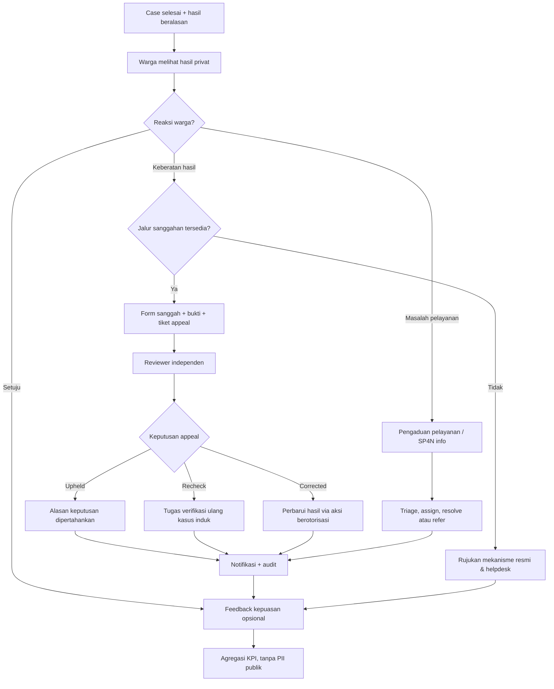

### 13.3 Transparency Center publik (P0)

Metrik aman: jumlah program per wilayah; total kasus per jenis, status, bulan; median durasi penanganan; jumlah kasus revisi/sanggahan yang ditangani; riwayat perubahan aturan program; metadata sumber aturan. **Jangan publikasikan** nama, NIK, alamat rinci, nomor telepon, foto wajah, dokumen, hasil AI individual, identitas pengadu, atau sel agregasi kecil yang memungkinkan identifikasi ulang. Gunakan ambang `k >= 10` sebagai **konfigurasi desain demo** (bukan angka wajib hukum) dan gabungkan/suppress kategori kecil.

### 13.4 Accountability Center internal (P0)

Metrik: backlog per assignment, aging, over-SLA terhadap SLA yang memang didefinisikan, frekuensi revisi, keputusan tanpa reason (harus 0), perubahan role, hasil appeal, audit read access, dan waktu AI downtime. Audit akses peristiwa sensitif, tetapi jangan gunakan AI anomaly untuk menuduh petugas/masyarakat korup tanpa investigasi. Kinerja statistik tidak menjadi basis otomatis menghukum petugas.

### Diagram 13 — Data visibility transparansi vs audit

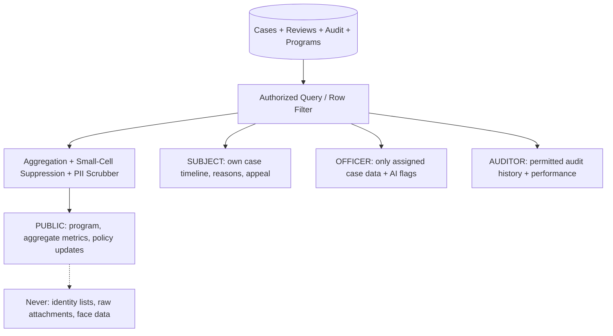

---

## 14. WHATSAPP STATIC BOT — TIDAK PAKAI LLM

**Prinsip:** satu nomor layanan, **menu dan state machine deterministik**, data status/program dari API dinamis. Tidak ada jawaban open-domain generatif. Login dan dokumen sensitif diselesaikan melalui website. Pengiriman WA harus menggunakan Meta WhatsApp Business Platform yang sah (sandbox untuk development).

### 14.1 Menu dan respons

| Input | Menu | Action backend | Respons aman |
|---|---|---|---|
| `1` | Informasi Program | `GET /api/v1/public/programs?territory=...` | nomor item, nama, area, periode, tautan web |
| `2` | Mulai pengajuan | pilih `DATA_PROPOSAL` / program | kirim tautan sekali pakai berumur pendek menuju web aman; jangan kirim dokumen ke WA |
| `3` | Cek status | masukkan tiket, lalu **verifikasi akun** via web | hanya status umum; detail privat setelah auth |
| `4` | Sanggahan | cari kasus terautentikasi | link halaman appeal dan panduan |
| `5` | Hubungi petugas | FAQ statis / handoff | kontak terverifikasi, jam layanan bila diketahui |
| `0` | Kembali | reset state | menu utama |

### 14.2 State machine WA

`INIT → MAIN_MENU → INFO_SELECT | APPLICATION_SELECT | STATUS_TICKET | APPEAL_GUIDE | HELP → (GENERATE_SECURE_LINK if needed) → MAIN_MENU`; sesi punya TTL, rate limit, reentrancy, idempotency untuk webhook duplicate.

### Diagram 14 — WhatsApp menu & web handoff

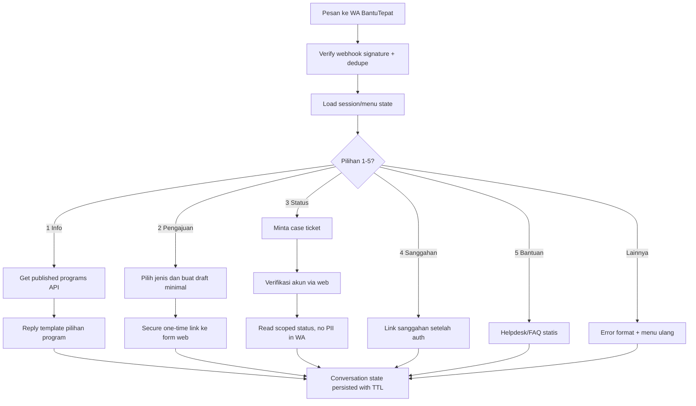

### 14.3 WhatsApp notification flow

- Event `CASE_STATUS_CHANGED` -> outbox -> recipient opted-in/allowed -> provider adapter -> approved template jika dibutuhkan -> delivery status callback; jika gagal, simpan error+retry serta notifikasi tetap terlihat di web.
- Implementasi melalui SDK/API Meta yang berlaku, jangan meng-hardcode nomor aktif atau token ke repository. Gunakan provider mock `WA_PROVIDER=mock` untuk demo bila onboarding nomor belum selesai.
- Validasi tanda tangan webhook provider berdasarkan spesifikasi saat integrasi, replay/duplicate check, origin policy yang benar, throttling.
- **Nomor tiket saja bukan autentikasi** dan balasan nomor WhatsApp tidak otomatis membuktikan identitas pemohon.

---
## 15. AI ARCHITECTURE — TERPISAH DARI CORE BUSINESS RULES

**AI hanya asisten keputusan manusia.** Untuk MVP gunakan **1 Python FastAPI service CPU** dengan router `/anomaly`, `/face` (flag opsional), dan `/rag`. Akses AI diproksi melalui backend aplikasi; tidak ada frontend langsung memanggil AI service privat, dan tidak ada frontend langsung memanggil LLM provider dengan API key. Jika AI down, kasus **tetap dapat diajukan** dan petugas dapat memeriksa manual.

### 15.1 Matriks AI dan non-AI

| Modul | Kategori | Kapan berjalan | Masukan | Keluaran | Priority | Fallback |
|---|---|---|---|---|---|---|
| Eligibility/time/territory rules | **Deterministik, bukan AI** | browse form, submit, review | policy version, role, region, time | valid/error/reason | P0 | harus selalu aktif |
| Duplicate check | **Deterministik** | submit | household/case keys internal | kemungkinan duplikat dan referensi tiket aman | P0 | manual review |
| Anomaly Detection | ML tabular | setelah submit/resubmit | fitur konsistensi yang minim & berizin | score, flags, version | P1 utama | `AI_UNAVAILABLE`, review manual |
| LLM + RAG | LLM eksternal via API | widget bantuan **web** | pertanyaan umum + retrieved public docs | jawaban + sitasi + batasan | P1 | FAQ statis |
| Face verification 1:1 | model vision CPU | verifikasi risiko tertentu, opt-in demo | selfie/live capture + referensi berizin + quality | match/uncertain + manual path | P2 | verifikasi manual |
| Passive liveness/PAD | anti-spoofing | bagian face 1:1 | capture liveness yang dibenarkan | PAD result | P2 | manual, bukan auto reject bansos |
| OCR | vision/text | unggah dokumen relevan | image scan aman | extracted fields | P2/tunda | isi manual |

### 15.2 AI anomaly detection — rancangan teknis dan evaluasi

**Input minimal:** fitur numerik/boolean yang relevan dan tidak berlebihan; mis. ukuran rumah tangga, jumlah tanggungan, rentang pendapatan self-report, delta pendapatan terhadap riwayat sintetis, status pekerjaan, selisih/konsistensi antarformulir, jumlah kasus aktif keluarga (rule), dan indikator perubahan data. Hindari memasukkan atribut sensitif yang tidak relevan atau proxy diskriminatif. **Tidak boleh** menggunakan latar etnis, agama, wajah, atau penampilan sebagai prediktor kelayakan.

**Model awal:** Isolation Forest / unsupervised baseline di scikit-learn. Anomali bukan bukti salah sasaran. Bandingkan dengan baseline rules, perhitungan precision/recall/F1 pada label anomali sintetis jika ada (label merupakan skenario yang dibuat, bukan *ground truth* kelayakan), FPR, review workload per 100 kasus, latency dan stabilitas multi-seed. Jangan menulis “akurasi 99%” tanpa eksperimen.

**Format data inference hasil:**

```json
{
  "case_id": "BT-P-2026-0007",
  "assessment_id": "uuid",
  "module": "tabular_anomaly",
  "model_version": "iforest-0.1.0",
  "feature_schema_version": "1.0",
  "status": "COMPLETED",
  "score": -0.083,
  "flagged_for_review": true,
  "flags": [
    {"code": "INCOME_CHANGE_RECHECK", "source": "MODEL", "message": "Perubahan kondisi ekonomi perlu dikonfirmasi"},
    {"code": "POSSIBLE_ACTIVE_DUPLICATE", "source": "RULE", "message": "Ada usulan serupa yang masih aktif"}
  ],
  "eligibility_decision": null,
  "auto_rejection": false
}
```

**Penting:** penjelasan model harus sesuai metode. Jika menggunakan Isolation Forest, daftar flag `INCOME_CHANGE_RECHECK` boleh berasal dari rule/data diff; jangan mengklaim model memberi penjelasan kausal/SHAP bila tidak dihitung. `source` wajib `RULE` atau `MODEL` agar petugas tidak menganggap semuanya “keputusan AI”.

### Diagram 15 — AI anomaly pipeline, human decision dan fallback

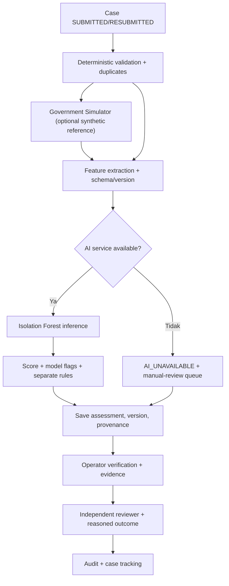

### 15.3 LLM + RAG web-only

**Tujuan:** menolong pengunjung/warga memahami syarat, wilayah, waktu, jalur pengajuan, prosedur sanggahan, dan arti status secara umum. **Tidak** boleh membuat keputusan, mengaku sebagai pemerintah, mengungkap status privat tanpa auth, menulis perubahan pada case, atau menjawab dengan dokumen yang belum disetujui.

**Pipeline:** admin knowledge mengimpor dokumen/URL resmi + tanggal berlaku → internal reviewer menyetujui dokumen → split/chunk → index/search (Postgres full-text cukup untuk MVP; embeddings/pgvector opsional) → user query sanitization → retrieve top-k → batas context, sitasi setiap klaim normatif → call external LLM via server API → response with citations/confidence disclaimer. Kalau dokumen tidak memadai, jawab “Informasi belum tersedia dalam dokumen terverifikasi” + link resmi. Gunakan model API yang tersedia sesuai anggaran, env config `LLM_PROVIDER`, `LLM_MODEL`, `LLM_API_KEY`.

**Guardrails:** tidak mengirim NIK, alamat, catatan pengajuan pribadi, token/secret, ataupun prompt internal ke LLM provider; input/output rate limit, moderation/profanity, max tokens, timeout, spend cap, logging tanpa isi chat sensitif, prompt-injection resistance dengan memperlakukan dokumen retrieval sebagai DATA bukan instruksi. Tidak menyimpan chat tanpa kebutuhan/notice; session TTL.

### Diagram 16 — Web chatbot LLM + RAG (tidak melewati WhatsApp)

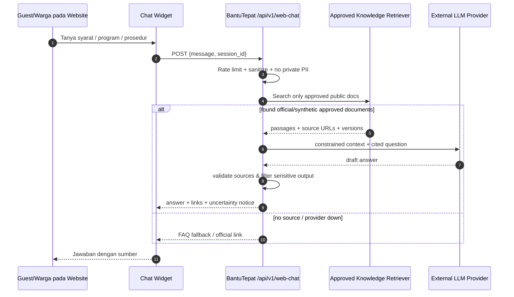

### 15.4 Face verification: aman dan tetap bisa di-deploy

**Kebutuhan nyata:** Face **verification 1:1** memeriksa kecocokan dua representasi dari identitas yang sudah mempunyai dasar referensi tepercaya. Untuk prototipe, gunakan referensi **relawan yang secara eksplisit menyetujui demo atau synthetic portrait yang sesuai untuk uji teknis**. Jangan mengklaim foto KTP unggahan sendiri adalah verifikasi Dukcapil/e-KYC sah. Tidak ada pencarian wajah massal 1:N, face attribute inference, atau penyimpanan galeri wajah penduduk.

**Opsi implementasi CPU:** Python 3.11, FastAPI, OpenCV/Pillow untuk preprocessing/quality (jika perlu), ONNX Runtime CPU untuk lightweight face embedder, comparator cosine similarity yang dikalibrasi menggunakan data uji demo, dan PAD/liveness ringan **hanya bila diuji**; quality and PAD failure = `MANUAL_REVIEW` (bukan penolakan bansos). Model harus diverifikasi **lisensi deployment/commercial-use** sebelum digunakan; lisensi kode dan bobot model dapat berbeda. Hindari asumsi bahwa semua bobot InsightFace/ArcFace bebas digunakan di layanan publik.

**Rencana operasional:**

1. `FACE_FEATURE_ENABLED=false` secara default, UI punya jalur manual.
2. Web minta izin dan informasi pemrosesan spesifik; referensi disediakan melalui proses demo yang berizin (enrollment tidak otomatis dari KTP user).
3. Capture wajah via browser HTTPS; batasi ukuran; kirim ke backend via HTTPS dan forward ke AI service authenticated. Jangan simpan gambar mentah di log/analytics.
4. Face service: validate MIME/size → quality → liveness/PAD bila tersedia → embed → 1:1 compare → hasil `MATCH`, `NO_MATCH`, `INDETERMINATE`, `MANUAL_REQUIRED`.
5. SIMPAN hanya hasil minimal, versi model, waktu, dasar pemrosesan, masa retensi; **default buang temporary image/embedding** setelah request (atau penyimpanan terenkripsi dan terikat ke kebijakan bila benar-benar diperlukan).
6. Pisahkan storage privat, akses staf sangat terbatas, enkripsi at rest/in transit, retensi minimum, delete request pathway.
7. Verifikasi identitas manual selalu tersedia; kegagalan wajah/warna kulit/lighting/camera tidak otomatis menyatakan warga tidak layak menerima bantuan.
8. Evaluasi `FMR` (false match rate), `FNMR` (false non-match rate), kegagalan deteksi/liveness, latency pada hardware hosting nyata, dan bias antar kondisi uji. Tidak membuat klaim e-KYC/anti-spoofing sempurna.

**Penilaian risiko privasi:** data biometrik termasuk data pribadi spesifik pada UU 27/2022, dan pemrosesan berisiko tinggi dapat memerlukan penilaian dampak pelindungan data pribadi; konsultasi/persetujuan penyelenggara serta aturan terkait diperlukan sebelum pemakaian nyata. Jika belum siap, **jangan deploy face module secara publik sebagai verifikasi wajib**. Tampilkan demo yang tidak menyimpan biometrik dengan relawan berizin dan hak untuk berhenti/menarik persetujuan bila relevan.

### Diagram 17 — Face 1:1, PAD dan alternative manual

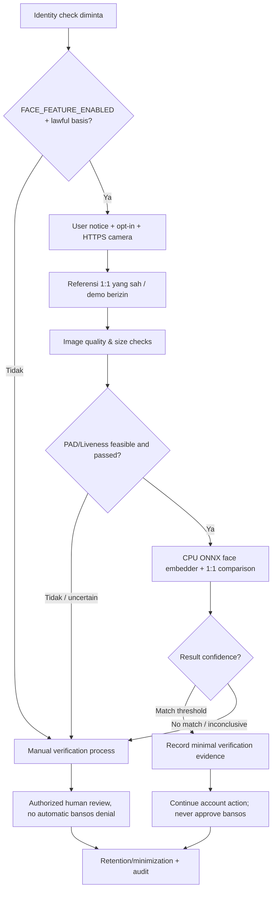

### 15.5 What is NOT supported

- Face recognition 1:N mencari warga pada database nasional.
- Automatic rejection due to face mismatch or AI risk score.
- LLM natural language “menilai kelayakan” dari foto kemiskinan/rumah.
- Crawling DTSEN/Dukcapil publik seolah API terbuka.
- Inferensi atribut sensitif atau pembuatan ranking warga yang tidak diatur program.

---

## 17. FRONTEND ↔ BACKEND SEQUENCE DIAGRAMS

### Diagram 18 — Warga submit, AI async, petugas dan verifikator

```mermaid
sequenceDiagram
    autonumber
    actor C as Masyarakat
    participant W as Next.js Frontend
    participant A as BantuTepat API
    participant R as Rules+RBAC
    participant DB as PostgreSQL
    participant AI as FastAPI AI
    actor O as Operator
    actor V as Verifikator
    C->>W: Buka program; isi pengajuan
    W->>A: GET program and requirements
    A-->>W: mode/area/period/version
    C->>W: Submit
    W->>A: POST application submit + idempotency
    A->>R: Validate role/territory/period
    alt precheck failed
      R-->>A: reason code
      A-->>W: 422 with corrective action
      W-->>C: Tampilkan alasan sebelum submit
    else valid
      A->>DB: INSERT case + audit + outbox (transaction)
      A-->>W: 201 case_id/ticket_no
      W-->>C: Tiket dan status PRECHECKED
      A->>AI: Async anomaly check, not blocking submit
      AI-->>A: Flags or timeout
      A->>DB: Save AI status/result with provenance
      O->>A: Open assigned case
      A-->>O: Case + rules + AI flags
      O->>A: Verify + reason
      A->>DB: Save review + audit
      V->>A: Final internal review; independent actor
      A->>R: Authorization + separation-of-duties
      A->>DB: Save decision + audit + notification outbox
      C->>W: Lihat detail kasus
      W->>A: GET /cases/:id
      A-->>W: status + reason + timeline + appeal option
      W-->>C: Tampilkan hasil
    end
```

### Diagram 19 — Penolakan administratif, sanggahan dan hasil revisi

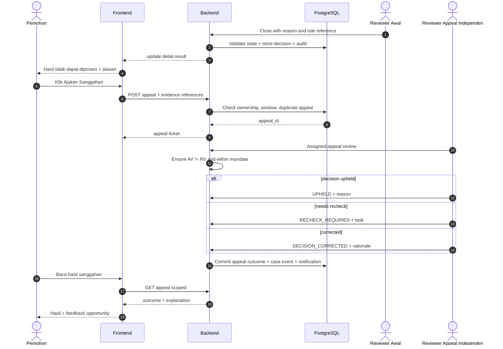

### Diagram 20 — Privacy-aware authentication/authorization

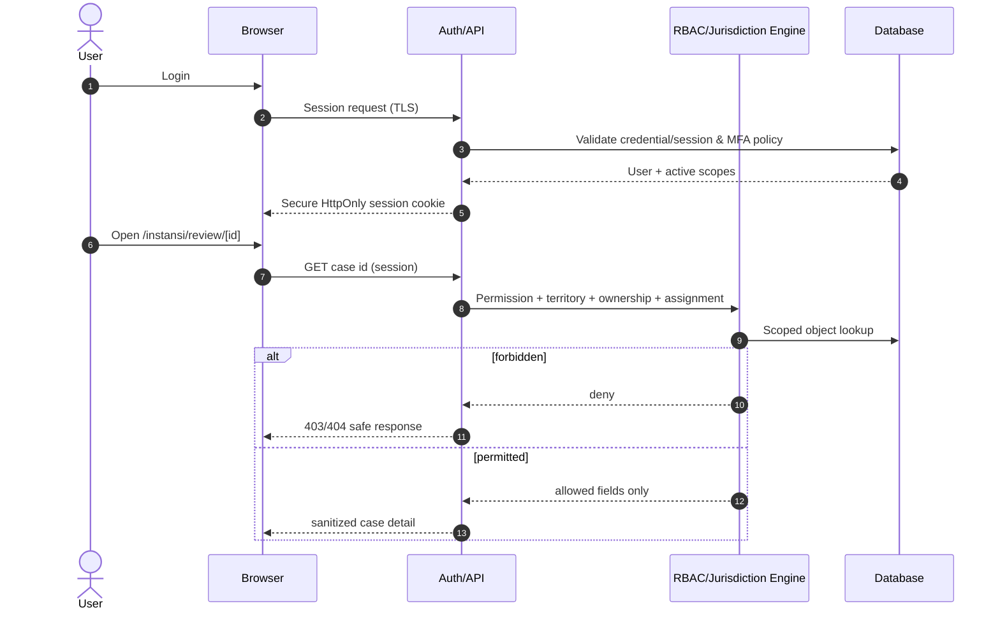

---

## Catatan integrasi workflow

Kontrak v1.2: lihat `phase0/STATE_CONTRACT.md`; diagram sumber 30 nomor adalah arsip historis. Gunakan Diagram 11 v1.2 di dokumen ini.

