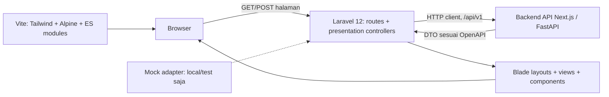

# Arsitektur frontend Laravel BantuTepat

Status: rancangan FE-00 untuk review; belum menjadi kontrak backend yang disetujui.

## Batas tanggung jawab

Laravel adalah presentation layer: menerima navigasi web, memanggil endpoint backend resmi melalui API client, memetakan response aman untuk Blade, lalu merender tampilan. Backend Next.js dan/atau FastAPI tetap pemilik autentikasi terkontrak, policy, state transition, validasi bisnis, data, keputusan, dan audit. Browser tidak mengakses database bisnis atau internal service.



Mock adapter hanya untuk pengembangan dan tes setelah kontrak disepakati. Mock menggunakan data sintetis dan bentuk response API yang sama; tidak boleh aktif pada production atau menampilkan sukses palsu.

## Susunan modul target

```text
app/
  Http/Controllers/                  # baca API resmi, siapkan view data, sajikan halaman
  Http/Middleware/                   # guard presentasi/session sesuai ADR; bukan authorization backend
  Services/Api/                      # client, error mapping, auth/session handoff
  View/                              # composers/view-model ringan bila mengurangi duplikasi
resources/
  views/layouts/                     # public, auth, private
  views/components/                  # ui, public, citizen, regional, agency, administration
  views/public/                      # halaman PUB
  views/auth/                        # login, daftar, lupa sandi
  views/citizen/                     # dashboard dan alur warga
  views/regional/                    # usulan dan tugas wilayah
  views/agency/                      # review dan program
  views/administration/              # audit, pengguna, wilayah, integrasi
  views/errors/                      # halaman aman 403/404/5xx
  css/                               # tokens, base, layout, components
  js/components/                     # interaksi UI generik
  js/features/                       # interaksi fitur dengan ES modules
routes/
  web.php                            # semua 42 URL kanonik
tests/                               # unit, feature, contract, browser sesuai gate QA
```

Susunan di atas adalah target modular; implementasi boleh memakai subfolder tambahan jika tetap konsisten dengan prompt. Tidak membuat domain model, migration, worker, sistem auth/RBAC sendiri, atau endpoint API pengganti.

## Request dan data flow

1. Route bernama di routes/web.php memilih presentation controller atau Blade statis.
2. Controller hanya mengambil data via app/Services/Api, menerapkan mapping tampilan, dan mengembalikan view. Tidak menghitung eligibility, memutus transisi, atau menulis status bisnis.
3. API client menggunakan BACKEND_API_URL pada server dan base path /api/v1. URL production tidak ditulis di source.
4. DTO/error dibaca dari OpenAPI v1.2 setelah kontrak dibekukan. Jangan buat DTO kedua secara manual atau mengarang endpoint untuk menutup UI gap.
5. View menampilkan state dan capability dari response. Menyembunyikan menu bukan pengganti authorization server.
6. Mutasi hanya dianggap berhasil setelah response backend mengonfirmasi hasil. Idempotency key, expected_version, CSRF, dan sesi mengikuti kontrak gabungan yang disepakati.

## Autentikasi dan sesi — keputusan belum dibekukan

Dokumen Phase 0 mengusulkan Supabase Auth dan BFF Next.js same-origin; prompt terbaru mengubah frontend menjadi Laravel tetapi melarang asumsi bahwa Laravel session/Sanctum kompatibel otomatis. Sebelum halaman auth atau API proxy dibuat, backend dan FE perlu menetapkan pemilik cookie/session, callback/MFA, CSRF, Origin, penerusan header, timeout, logout/revocation, dan same-origin deployment. Jangan menyimpan token di localStorage atau mengirim rahasia backend ke browser.

FE guard hanya mengikuti response pengguna/capability dari backend yang disetujui. Backend tetap mengecek role, permission, wilayah, mandat, assignment, status, ownership, dan maker-checker pada setiap request.

## Role shell

- Guest: PublicHeader dan PublicFooter.
- CITIZEN: private shell dengan urutan tindakan diperlukan, pengajuan, notifikasi, dan program.
- REGIONAL_PROPOSER dan VILLAGE_OPERATOR: shell wilayah dengan scope terlihat, tetapi konten/action dibedakan berdasarkan izin dan tugas.
- AGENCY_VERIFIER dan PROGRAM_MANAGER: shell instansi dengan antrean review atau versi program sesuai grant.
- AUDITOR dan SUPER_ADMIN: shell administrasi read-only audit/monitoring atau administrasi teknis sesuai izin; SUPER_ADMIN bukan penentu hasil kasus.
- Desktop: sidebar 248 px dan topbar. Mobile: drawer; bottom navigation hanya untuk layar warga yang sesuai, tidak untuk wizard/review.

## Design system dan state

Sumber token adalah docs/BantuTepat_UIUX_Design_v1.0/tokens.css. Saat dikompilasi untuk Tailwind 4, salin atau rujuk satu sumber canonical tanpa drift. Gunakan palet Jalur Jelas, token semantic, Plus Jakarta Sans lokal setelah lisensi diverifikasi, Lucide Icons, dan Bahasa Indonesia. Jangan menambahkan template dashboard, gradient, dekorasi, atau animasi berlebih.

Setiap layar mengimplementasikan state relevan: initial, loading, success/ready, empty, error, disabled, validation, permission denied; tambahkan session expired/conflict sesuai kontrak. Data kosong, gagal fetch, suppressed, dan nilai nol adalah kondisi berbeda. Gunakan data sintetis hanya di mode development/test.

## Responsive, accessibility, privacy

Targetkan viewport 360, 390, 430, 768, 1280, dan 1440 px; reflow 320 px dan zoom 200% juga tercantum dalam panduan. Target desain WCAG 2.2 AA mencakup semantic HTML, keyboard, focus visible, label/error association, dialog focus, reduced motion, kontras, dan target sentuh. Ini target, bukan klaim lulus.

Tidak ada data warga sungguhan. Data pribadi tidak masuk URL, localStorage, log, analytics publik, atau cache bersama. Lampiran hanya private storage backend; link signed hanya sesuai izin dan masa berlaku. Statistik publik harus disuppression server. Status simulasi diberi label.

## Aturan Laravel yang wajib

- Laravel HTTP Client hanya di server. Jangan memanggil service internal/M2M dari JavaScript browser.
- Jangan membuat Eloquent model atau schema bisnis; model User bawaan tidak membuktikan integrasi auth.
- Jangan menerapkan state machine atau business logic ke controller, Blade, JavaScript, maupun database Laravel.
- Jangan mengubah OpenAPI, role, permission, URL, workflow, atau flag fitur sepihak.
- Jaga kode demo saat ini terpisah dari adapter API. Prefix /demo dan data session bukan autentikasi atau integrasi produksi.
- Tidak mengklaim target accessibility, build, performance, atau browser QA sampai hasilnya benar-benar diukur.
